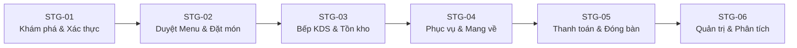

# Product Requirements Document (PRD) theo User Stage — QROS (`03-ba`)

> **Tầng Knowledge:** `03-ba` (Business Analysis — Product Requirements Definition)  
> **Sinh bởi Skill:** `.agents/skills/ba-prd/SKILL.md`  
> **Kế thừa bắt buộc từ:**
> - **PO (`01-po/`):** [project-intake.md](../01-po/project-intake.md) · [personas.md](../01-po/personas.md) (`PER-01` → `PER-06`) · [journey-features.md](../01-po/journey-features.md) (`STG-01` → `STG-06`, `F1.1` → `F6.8` — 38 tính năng) · [blueprint.md](../01-po/blueprint.md)
> - **Design (`02-design/`):** [DESIGN_SYSTEM.md](../02-design/DESIGN_SYSTEM.md) · [PROTOTYPE_SCREEN_MAP.md](../02-design/PROTOTYPE_SCREEN_MAP.md) (`SCR-01` → `SCR-28`)  
> **Bàn giao cho:** [USER_STORIES.md](./USER_STORIES.md) · [SYSTEM_DESIGN.md](../04-tech/SYSTEM_DESIGN.md)

---

## 1. Tổng quan Phân tích Yêu cầu theo 6 Giai đoạn Người dùng (User Stages)

Tài liệu cụ thể hóa toàn bộ logic nghiệp vụ, **38 quy tắc nghiệp vụ (`BR-01` → `BR-38`)**, máy trạng thái, điều kiện hợp lệ và trường hợp biên dựa đồng thời trên **mục tiêu sản phẩm của PO (`01-po/`)** và **28 màn hình Prototype của Design (`02-design/`)**:



### Ma trận Phân quyền Nghiệp vụ 6 Vai trò (Tham chiếu xuyên suốt `BR-01` → `BR-38`)

| Nhóm quyền nghiệp vụ | `PER-01` Khách | `PER-02` Phục vụ | `PER-03` Bếp | `PER-04` Thu ngân | `PER-05` Quản lý | `PER-06` Chủ quán |
|---|:---:|:---:|:---:|:---:|:---:|:---:|
| Xem thực đơn & gọi món tại bàn (QR) | ✅ | ✅ | ✅ *(công khai)* | ✅ | ✅ | ✅ |
| Gọi nhân viên hỗ trợ tại bàn (`SCR-05`) | ✅ | ✅ *(công khai tại bàn)* | ✅ *(công khai tại bàn)* | ✅ *(công khai tại bàn)* | ✅ *(công khai tại bàn)* | ✅ *(công khai tại bàn)* |
| Sơ đồ bàn, đặt món hộ, gộp/hủy gộp bàn, đơn mang về | — | ✅ | — | ✅ | ✅ | ✅ |
| Hàng đợi yêu cầu bàn, nhận xử lý & hoàn tất (`SCR-27`) | — | ✅ | — | ✅ | ✅ *(can thiệp/hủy)* | ✅ *(can thiệp/hủy)* |
| AI Phân loại ghi chú khẩn & Cảnh báo dị ứng (`SCR-12`, `SCR-27`) | — | ✅ *(cấp sàn)* | ✅ *(KDS)* | ✅ *(kế thừa sàn)* | ✅ | ✅ |
| Màn hình Bếp KDS (Kanban, nấu gom, báo hết món) | — | — | ✅ | — | ✅ | ✅ |
| Xem kho, nhập kho (thủ công & hóa đơn AI), điều chỉnh tồn, AI Gợi ý nhập kho & kiểm tra giá vốn BOM (`SCR-18`) | — | — | ✅ *(không sửa BOM/giá vốn)* | — | ✅ | ✅ |
| Thanh toán tiền mặt/VietQR & tra cứu lịch sử hóa đơn | Tự thanh toán *(nếu bật)* | — | — | ✅ | ✅ | ✅ |
| Quản trị thực đơn, BOM, khuyến mãi, combo, nhân sự & AI Đề xuất Combo/Khuyến mãi | — | — | — | — | ✅ | ✅ |
| Báo cáo món bán chạy & hiệu suất nhân sự | — | — | — | — | ✅ | ✅ |
| AI Tóm tắt ca & Phân tích điều hành (`SCR-10`) | — | — | — | — | ✅ | ✅ |
| Báo cáo doanh thu chi tiết & dự báo nhu cầu AI (`SCR-22`, `SCR-25`) | — | — | — | — | ✅ | ✅ |
| Cài đặt hệ thống 7 tab (`SCR-26`) & xóa dữ liệu nhạy cảm (hóa đơn, nguyên liệu) | — | — | — | — | — | ✅ *(kèm 2FA)* |
| Gói dịch vụ & Nâng cấp Pro (`SCR-28`: xem gói, dùng thử 14 ngày, thanh toán VietQR) | — | — *(xem trạng thái gói)* | — *(xem trạng thái gói)* | — *(xem trạng thái gói)* | ✅ *(xem gói & hóa đơn)* | ✅ *(dùng thử & thanh toán)* |

---

## 2. Đặc tả chi tiết từng User Stage (`STG-01` → `STG-06`)

### `STG-01` — Khám phá, Quét QR, Xác thực & Bảo mật phiên
- **Truy vết:** Personas `PER-01..06` · PO Features `F1.1`, `F6.4`, `F6.5` · Screens `SCR-01..04`, `SCR-06..09`, `SCR-26`
- **Luồng chính:**
  1. Khách (`PER-01`) quét mã QR trên bàn → mở thẳng `SCR-05` hiển thị đúng số bàn mà không yêu cầu đăng nhập; có thể đổi ngôn ngữ `VI/EN` ngay trên thanh tiêu đề.
  2. Nhân sự (`PER-02..06`) truy cập `SCR-02` từ `SCR-01`, nhập email và mật khẩu; riêng Chủ quán (`PER-06`) bắt buộc vượt qua bước nhập **mã xác thực 2 lớp (OTP 6 số)** gửi qua email.
  3. Đăng nhập thành công → tự động chuyển tới không gian làm việc mặc định của từng vai trò (`PER-03` → `SCR-12`, `PER-02`/`PER-04` → `SCR-11`, `PER-05`/`PER-06` → `SCR-10`). Nếu tài khoản mới được cấp yêu cầu đổi mật khẩu lần đầu → chuyển tới `SCR-26` trước khi thao tác.
- **Luồng thay thế:** Nhân sự quên mật khẩu mở `SCR-03` gửi yêu cầu khôi phục → nhận liên kết đặt lại mật khẩu có thời hạn → đổi mật khẩu mới tại `SCR-04`.
- **Quy tắc nghiệp vụ (`BR-01` → `BR-04`):**
  - **`BR-01` (Xác thực bàn QR):** Mã QR bàn phải chứa định danh hợp lệ do nhà hàng phát hành. Nếu bàn đang ở trạng thái *Tạm ngưng* hoặc mã bàn không hợp lệ, hệ thống chặn thao tác đặt món trên `SCR-05` và hiển thị thông báo rõ ràng.
  - **`BR-02` (Xác thực 2 lớp Chủ quán):** Tài khoản `PER-06` bắt buộc xác minh OTP 6 số có thời hạn tuyệt đối **5 phút** mỗi lần đăng nhập; mã OTP được lưu ở dạng mã hóa một chiều và đối chiếu nguyên tử. Hệ thống giới hạn tối đa **5 lần nhập sai**, **3 lần gửi lại** trong cùng thời hạn 5 phút (không kéo dài thời hạn vô hạn) kèm thời gian chờ 60 giây giữa các lần bấm "Gửi lại mã" được kiểm soát nguyên tử và **bảo toàn số lần nhập sai hiện có** (hiển thị đếm ngược trên `SCR-02`). Nếu dịch vụ gửi email gặp sự cố, hệ thống hủy phiên chờ 2FA và trả thông báo tạm gián đoạn rõ ràng.
  - **`BR-03` (Chống dò tài khoản, chính sách mật khẩu & quản lý phiên đa thiết bị):** Đăng nhập sai liên tiếp vượt ngưỡng sẽ khóa tài khoản tạm thời; chức năng quên mật khẩu tại `SCR-03` luôn trả thông báo trung tính không tiết lộ tài khoản có tồn tại hay không, đồng thời chặn tài khoản đang ngưng hoạt động hoặc bị khóa khởi tạo/hoàn tất đặt lại mật khẩu; mã OTP khôi phục qua SMS tự động vô hiệu hóa sau **5 lần nhập sai**. Mật khẩu chấp nhận mọi ký tự đặc biệt tiêu chuẩn và giới hạn tối đa **72 byte UTF-8**. Mỗi tài khoản nhân sự (`PER-02..06`) hỗ trợ đăng nhập **đa thiết bị** độc lập (tối đa **10 phiên thiết bị** cùng lúc): đăng xuất chỉ thu hồi phiên của thiết bị hiện tại, trong khi đổi mật khẩu, đặt lại mật khẩu hoặc khóa/ngưng hoạt động tài khoản lập tức thu hồi **toàn bộ phiên trên mọi thiết bị** và điều hướng về `SCR-02`. Riêng màn hình Bếp KDS (`SCR-12`) được miễn tự động đăng xuất sau 20 phút không chạm màn hình để vận hành treo tường liên tục. Trong lúc tài khoản đang ở trạng thái bắt buộc đổi mật khẩu lần đầu, hệ thống khóa các thao tác sửa hồ sơ, tải ảnh đại diện và kênh đồng bộ nội bộ cho tới khi đổi mật khẩu hoàn tất.
  - **`BR-04` (Kiểm soát truy cập theo vai trò & bảo vệ Chủ quán cuối cùng):** Phân cấp thừa kế quyền tuân thủ nguyên tắc *Chủ quán > Quản lý > Thu ngân > Phục vụ* và *Quản lý > Bếp*. Truy cập màn hình ngoài quyền hạn phải chuyển hướng sang `SCR-06` (403); kho nguyên liệu (`SCR-18`) chỉ mở cho `PER-03`, `PER-05`, `PER-06` (chặn `PER-02`, `PER-04`). Hệ thống tuyệt đối cấm người dùng tự đổi vai trò hoặc tự vô hiệu hóa tài khoản của chính mình, đồng thời luôn duy trì tối thiểu **1 tài khoản Chủ quán (`PER-06`) đang hoạt động** (chặn hạ quyền hoặc khóa Chủ quán cuối cùng).
- **Trường hợp biên & Xử lý lỗi:**
  - Mất kết nối mạng → hiển thị `SCR-08` hoặc dải cảnh báo mất mạng có nút thử lại.
  - Đường dẫn sai hoặc sự cố bất ngờ → hiển thị màn hình thân thiện `SCR-07` (404) / `SCR-09` (không lộ thông tin nội bộ).
  - Liên kết đặt lại mật khẩu hết hạn hoặc đã sử dụng → báo lỗi rõ tại `SCR-04` và đề nghị gửi yêu cầu mới.

---

### `STG-02` — Duyệt Thực đơn, Trợ lý AI & Đặt món tại bàn
- **Truy vết:** Persona `PER-01` · PO Features `F1.2`, `F1.3`, `F1.4`, `F1.5`, `F1.6` · Screen `SCR-05`
- **Luồng chính:**
  1. Khách duyệt thực đơn theo danh mục, combo hoặc tìm kiếm trên `SCR-05`; chạm vào món để mở hộp thoại tùy chọn kích cỡ, topping phụ thu và nhập ghi chú khẩu vị.
  2. Khách có thể mở cửa sổ **Trợ lý AI** để hỏi gợi ý món theo sở thích, dị ứng, số lượng người hoặc ngân sách; hệ thống trả về câu trả lời kèm danh sách thẻ món/combo đang còn hàng để khách bấm thêm ngay vào giỏ hàng (hoặc mở hộp thoại chọn tùy chọn nếu món có kích cỡ/topping).
  3. Khách mở ngăn kéo giỏ hàng, kiểm tra số lượng, tạm tính (có hiển thị khuyến mãi tự động nếu đang áp dụng) và bấm **Gửi đơn**.
  4. Hệ thống tạo đợt gọi món mới cho phiên bàn, xóa giỏ hàng hiện tại và hiển thị tiến độ chế biến trực tiếp từng món trên ngăn kéo đơn hiện tại.
  5. Khi cần hỗ trợ tại chỗ, khách chạm nút **Gọi nhân viên** trên thanh tiêu đề của `SCR-05` → Bottom Sheet/Modal mở ra với 6 lý do chọn nhanh (*Thêm nước / Đá*, *Thêm chén đũa / Khăn giấy*, *Dọn bàn*, *Hỗ trợ gọi món*, *Gọi thanh toán*, *Khác*) và ô ghi chú tùy chọn → bấm gửi yêu cầu → theo dõi trực tiếp trạng thái (*Đang chờ tiếp nhận → Nhân viên [Tên] đang tới → Đã hoàn tất*) kèm đồng hồ đếm ngược thời gian chờ gửi lần tiếp theo.
- **Luồng thay thế:**
  - Trong suốt bữa ăn, khách (hoặc các thành viên khác cùng bàn / cùng nhóm bàn gộp) tiếp tục chọn và gửi thêm đợt gọi món mới; mọi đợt gọi đều cộng dồn vào chung một hóa đơn của phiên bàn.
  - Khách có thể bấm hủy yêu cầu gọi nhân viên ngay trên thẻ theo dõi của `SCR-05` khi yêu cầu vẫn đang ở trạng thái *Chờ tiếp nhận*.
- **Quy tắc nghiệp vụ (`BR-05` → `BR-08`, `BR-25` → `BR-26`, `BR-29` → `BR-30`):**
  - **`BR-05` (Trạng thái còn/hết món, sàn giá bán, giờ mở cửa & bảo vệ danh mục):** Món hoặc combo đã tắt bán hoặc hết nguyên liệu cốt lõi phải hiển thị nhãn *Hết hàng* và vô hiệu hóa thao tác thêm vào giỏ trên `SCR-05`; giá bán món lẻ và combo bắt buộc đạt **sàn tối thiểu `>= 1,000 VND`**. Khung **giờ mở cửa — giờ đóng cửa** của nhà hàng (hỗ trợ cả ca qua đêm khi giờ đóng cửa nhỏ hơn giờ mở cửa) được áp dụng chặt cho mọi đơn QR công khai từ khách (`PER-01`), trong khi nhân sự đặt món nội bộ không bị chặn. Hệ thống phân tách rạch ròi giữa **tạm ngừng thủ công** bởi Quản lý/Chủ quán với trạng thái **tạm hết do thiếu kho**: khi nhập thêm nguyên liệu, hệ thống chỉ tự động mở bán lại các món/combo bị tắt vì thiếu nguyên liệu và tuyệt đối không ghi đè các món/combo đang bị tạm ngừng thủ công; khi bật/tắt danh mục thì đồng bộ tự động khả dụng của các combo liên quan. Cấm xóa món hoặc combo đang tồn tại trong đơn hàng chưa kết thúc; mỗi lượt chọn tùy chọn trên món không được trùng lặp hoặc rỗng giá trị.
  - **`BR-06` (Chống gửi đơn trùng lặp):** Mỗi lần xác nhận gửi giỏ hàng phải được bảo vệ chống bấm đúp / gửi lặp khi mạng chập chờn — cùng một yêu cầu không bao giờ tạo ra 2 đợt gọi món giống nhau.
  - **`BR-07` (Gộp đợt gọi vào chung phiên bàn & tái sử dụng mã QR bàn):** Mọi lượt đặt thêm trong khi phiên bàn còn mở phải gắn vào cùng một đơn hàng tổng của phiên bàn đó, không tách rời nhiều hóa đơn cho cùng một bàn. Khi phiên bàn cũ đã kết thúc hoặc hết hạn, liên kết QR bàn vẫn giữ nguyên dấu xác thực bàn hợp lệ để khách mở phiên mới mượt mà mà không phải quét lại mã QR.
  - **`BR-08` (Cô lập lỗi & giới hạn Trợ lý AI):** Trợ lý AI tư vấn món chỉ gợi ý dựa trên các món đang mở bán của quán và có hạn mức lượt hỏi theo phiên/ngày; khi AI quá tải hoặc tạm tắt, trải nghiệm xem menu và đặt món cốt lõi vẫn hoạt động bình thường.
  - **`BR-29` (Tính xác thực & khả dụng của thẻ món AI gợi ý đặt trực tiếp):** Mọi thẻ món lẻ hoặc combo trả về trong khung chat AI bắt buộc được hệ thống đối chiếu trực tiếp với danh mục thực đơn hiện hành (đang bật bán và đang còn hàng — lọc bỏ hoàn toàn món tạm ngưng hoặc hết nguyên liệu). Tên hiển thị, đơn giá, ảnh đại diện, danh mục và việc món có nhóm tùy chọn bắt buộc lấy từ dữ liệu chuẩn của quán (tuyệt đối không tin đơn giá hay tên tự sinh), giới hạn tối đa **5 thẻ** mỗi lượt trả lời. Nếu phản hồi từ AI không kèm gợi ý hợp lệ hoặc bị lỗi định dạng cấu trúc, hệ thống tự động hạ cấp an toàn về câu trả lời văn bản thuần túy không kèm thẻ gợi ý.
  - **`BR-30` (Quy tắc thêm vào giỏ hàng trực tiếp từ khung chat AI):** Thao tác bấm `+ Thêm` / `Chọn tùy chọn` trên thẻ gợi ý trong khung chat tuân thủ đầy đủ kiểm soát đặt món giống menu chính (`BR-01`, `BR-05`, khóa khi bàn đang chờ thanh toán hoặc quán đang bảo trì/ngưng nhận đơn). Với món có tùy chọn/topping, hệ thống tự động mở hộp thoại chọn tùy chọn và tạm ẩn khung chat để khách chọn đúng kích cỡ/topping trước khi vào giỏ; với món không có tùy chọn hoặc combo khả dụng, thêm trực tiếp vào giỏ hàng dùng chung và đồng bộ tức thì số lượng đang có trong giỏ. Hỗ trợ nút thêm nhanh toàn bộ các món không cần chọn tùy chọn trong cùng lượt gợi ý và lối tắt mở ngay ngăn kéo giỏ hàng.
  - **`BR-25` (Điều kiện hợp lệ, lý do nhanh & ghi chú gọi nhân viên):** Khách bắt buộc phải có phiên bàn đang mở hợp lệ tại bàn không ở trạng thái *Tạm ngưng* (kèm mã xác thực phiên bàn hợp lệ) và chọn 1 trong 6 lý do chuẩn. Khi chọn lý do *Khác*, bắt buộc nhập ghi chú tối thiểu 2 ký tự (sau cắt khoảng trắng); với mọi lý do, ghi chú tối đa 200 ký tự. Khi bàn đang nằm trong nhóm bàn gộp, yêu cầu luôn gắn chính xác số bàn vật lý khách đang quét QR kèm ngữ cảnh phiên bàn chung để nhân viên tìm đúng vị trí. Việc chọn lý do *Gọi thanh toán* chỉ gửi yêu cầu phục vụ hỗ trợ hóa đơn tại bàn, không tự ép chuyển trạng thái bàn chờ thanh toán nếu vẫn còn món chưa xong.
  - **`BR-26` (Chống bấm spam & trùng lặp yêu cầu gọi nhân viên — 3 lớp):**
    1. *Chống bấm đúp / gửi lặp:* Mỗi lần gửi kèm mã định danh lượt yêu cầu duy nhất để tránh mạng chậm sinh ra 2 yêu cầu giống hệt nhau.
    2. *Thời gian chờ giữa 2 lần gửi (Cooldown):* Mỗi bàn chỉ được gửi tối đa 1 yêu cầu mới trong mỗi khoảng chờ tối thiểu **60 giây**; trong thời gian chờ, giao diện `SCR-05` hiển thị đồng hồ đếm ngược và khóa nút gửi mới.
    3. *Chặn trùng lý do & giới hạn hàng đợi mở:* Không cho phép gửi một yêu cầu mới có **cùng lý do** với một yêu cầu đang mở (*Chờ tiếp nhận* hoặc *Đang xử lý*) của bàn đó, và mỗi phiên bàn tối đa chỉ có **3 yêu cầu đang mở** đồng thời.
- **Trường hợp biên & Xử lý lỗi:**
  - Món trong giỏ vừa bị quản lý tắt bán hoặc hết hàng ngay trước khi bấm gửi → báo rõ tên món không khả dụng, giữ nguyên các món hợp lệ còn lại trong giỏ để khách điều chỉnh.
  - Khách lỡ đóng trình duyệt rồi quét lại mã QR bàn → vẫn hiển thị đúng danh sách các món đã gọi, các yêu cầu gọi nhân viên đang mở của bàn và thời gian đếm ngược cooldown còn lại (nếu chưa hết 60 giây).
  - Khách mất mạng khi vừa bấm gửi yêu cầu gọi nhân viên → hiển thị thông báo kiểm tra kết nối, không làm mất nội dung ghi chú đang nhập, giữ nguyên nút thử lại và không tạo trùng yêu cầu khi gửi lại cùng mã định danh lượt yêu cầu.
  - Bàn bị chuyển sang *Tạm ngưng* hoặc phiên bàn vừa kết thúc thanh toán trước khi khách bấm gửi yêu cầu → từ chối tạo yêu cầu mới và hiển thị thông báo phiên bàn đã đóng / tạm ngưng.

---

### `STG-03` — Tiếp nhận Bếp (KDS) & Tự động Giữ/Trừ Tồn kho
- **Truy vết:** Personas `PER-03`, `PER-05` · PO Features `F2.1`–`F2.6`, `F5.1`–`F5.8` · Screens `SCR-12`, `SCR-18`
- **Luồng chính:**
  1. Ngay khi có đơn từ khách tại bàn (`STG-02`), nhân viên đặt hộ hoặc đơn mang về (`STG-04`), món xuất hiện tức thì (< 1 giây) ở cột **Chờ chế biến** trên `SCR-12` kèm chuông báo.
  2. Đầu bếp (`PER-03`) có thể làm việc ở chế độ **Kanban** (theo từng đơn/bàn) hoặc chuyển sang chế độ **Nấu gom theo mẻ** (gộp tổng số lượng các phần cùng món kèm ghi chú từng bàn), sau đó chuyển trạng thái món tuần tự: *Chờ chế biến → Đang nấu → Hoàn tất*.
  3. Dựa trên công thức định lượng món (BOM), hệ thống tự động giữ chỗ và khấu trừ nguyên liệu trong kho; khi nguyên liệu giảm dưới ngưỡng an toàn, cảnh báo hiển thị ngay trên `SCR-18`.
  4. Đầu bếp hoặc Quản lý có thể lập phiếu **Nhập kho**, **Điều chỉnh tồn kho**, hoặc bấm **"Nhập từ hóa đơn AI"** trên `SCR-18` để quét ảnh hóa đơn mua hàng, rà soát quy đổi đơn vị và nhập kho hàng loạt.
- **Máy trạng thái món tại Bếp:**
  ```text
  [Chờ chế biến] ──► [Đang nấu] ──► [Hoàn tất]
        │                │
        └──► [Đã hủy] ◄──┘  (Bắt buộc có lý do; hoàn lại lượng nguyên liệu đã giữ)
  ```
- **Quy tắc nghiệp vụ (`BR-09` → `BR-12`, `BR-32`, `BR-34` → `BR-36`):**
  - **`BR-09` (Quyền truy cập khu vực Bếp):** Chỉ `PER-03` (Bếp), `PER-05` (Quản lý) và `PER-06` (Chủ quán) được mở `SCR-12` và thay đổi trạng thái chế biến; Phục vụ và Thu ngân không được thao tác trên KDS.
  - **`BR-10` (Chuyển trạng thái hợp lệ, khóa sau thanh toán & hủy món):** Món chỉ được tiến tuần tự một chiều *Chờ chế biến → Đang nấu → Hoàn tất* (**không thể hoàn tác** từ *Hoàn tất* quay lại *Đang nấu* hay *Chờ chế biến* nhằm bảo toàn lượng nguyên liệu đã tiêu thụ). Hủy món trước khi hoàn tất bắt buộc chọn/nhập lý do (ví dụ: hết nguyên liệu) và tự động gửi thông báo tới bàn/phục vụ; nếu đơn đã được thanh toán hoặc đang có giao dịch thanh toán trực tuyến chờ xử lý thì **cấm** sửa số lượng, gọi thêm hoặc hủy món (chỉ cho phép bếp tiếp tục chế biến các món đã thanh toán tới *Hoàn tất*). Khi toàn bộ món tính tiền trong một đơn bị hủy hết, hệ thống tự động hủy đơn và đóng luôn phiên bàn liên quan để tránh treo bàn.
  - **`BR-11` (Toàn vẹn tồn kho, khóa đơn vị tính & truy vết biến động):** Mọi thao tác giữ/trừ nguyên liệu từ đơn, hoàn kho khi hủy món, nhập kho hay điều chỉnh kho đều phải xử lý an toàn khi có nhiều đơn đồng thời (không để thất thoát/lệch số liệu) và ghi đầy đủ lịch sử biến động (người thực hiện, thời điểm, số lượng trước/sau, lý do). Hệ thống chặn xóa nguyên liệu khi vẫn còn lượng đang giữ chỗ cho đơn hoạt động hoặc công thức còn hiệu lực, **khóa thay đổi đơn vị tính** của nguyên liệu đang nằm trong công thức định lượng (BOM) hoặc đang có giữ chỗ tồn kho, **chặn nhập kho/điều chỉnh tồn** trên nguyên liệu đã ngưng hoạt động, đồng thời tự động dọn công thức định lượng khi món ăn bị xóa.
  - **`BR-12` (Cảnh báo quá giờ & thiếu tồn kho):** Món vượt ngưỡng thời gian chờ tiêu chuẩn (20 phút) phải tự động nổi bật bằng màu `Danger` (theo `DESIGN_SYSTEM.md`) và phát âm thanh nhắc trên `SCR-12`. Khi nguyên liệu chạm đáy hoặc không đủ trừ, hệ thống hiển thị cảnh báo thiếu tồn kho rõ ràng trên `SCR-18` mà không làm đứng hoạt động chế biến.
- **Trường hợp biên & Xử lý lỗi:**
  - Hai bàn đặt đồng thời phần món cuối cùng dùng chung một nguyên liệu → hệ thống kiểm soát xung đột, tránh trừ sai số lượng và cảnh báo kịp thời.
  - Đầu bếp (`PER-03`) được nhập/điều chỉnh tồn kho trên `SCR-18` nhưng **không** được sửa công thức định lượng món (BOM) và **không** được xóa nguyên liệu.

---

### `STG-04` — Phục vụ tại bàn, Hàng đợi Yêu cầu, Gộp bàn & Đơn Mang về
- **Truy vết:** Personas `PER-02`, `PER-04`, `PER-05`, `PER-06` · PO Features `F4.1`–`F4.5` · Screens `SCR-11`, `SCR-13`, `SCR-27`
- **Luồng chính:**
  1. Nhân viên phục vụ (`PER-02`) quan sát sơ đồ bàn đồng bộ tức thì trên `SCR-11` với 4 trạng thái màu ngữ nghĩa (*Trống*, *Đang có khách*, *Chờ thanh toán*, *Tạm ngưng*) kèm badge số yêu cầu hỗ trợ đang mở ngay trên từng thẻ bàn.
  2. Khi khách tại bàn gửi yêu cầu hỗ trợ mới, yêu cầu lập tức xuất hiện trên đầu hàng đợi **`SCR-27`** *(sắp xếp yêu cầu chờ lâu nhất lên trước)* kèm chuông báo (nếu bật). Nhân viên phục vụ bấm **"Nhận xử lý"** để khóa nhận yêu cầu đó về mình, ra bàn hỗ trợ khách và bấm **"Hoàn tất"** sau khi phục vụ xong.
  3. Khi khách không dùng smartphone, nhân viên mở chi tiết bàn trên `SCR-11` để đặt món hộ; khi bếp hoàn tất món, nhân viên nhận thông báo để bưng ra đúng bàn.
  4. Khi khách đi nhóm đông, nhân viên mở hộp thoại **Gộp bàn** trên `SCR-11` chọn các bàn cần ghép để dùng chung một phiên phục vụ và một hóa đơn tổng; có thể hủy gộp nếu thao tác nhầm trước khi thanh toán.
  5. Với khách mua mang về, nhân viên hoặc thu ngân tạo và theo dõi đơn riêng tại `SCR-13`.
- **Máy trạng thái Bàn ăn:**
  ```text
  [Trống] ◄──► [Đang có khách] ──► [Chờ thanh toán] ──► [Trống]
     ▲
     └────────► [Tạm ngưng] (Chỉ Quản lý / Chủ quán bật tắt)
  ```
- **Máy trạng thái Yêu cầu Hỗ trợ tại Bàn (`F1.6`, `F4.5`):**
  ```text
  [Chờ tiếp nhận (PENDING)] ──(1 nhân viên nhận xử lý)──► [Đang xử lý (CLAIMED)] ──(Hoàn tất)──► [Đã hoàn tất (RESOLVED)]
              │                                                    │
              └──────────(Khách hủy / Đóng phiên / Quản lý hủy)────┴──────► [Đã hủy (CANCELLED)]
  ```
- **Quy tắc nghiệp vụ (`BR-13` → `BR-15`, `BR-27` → `BR-28`):**
  - **`BR-13` (Chuyển trạng thái bàn & trả bàn trống):** Bàn *Tạm ngưng* không được mở phiên đón khách, không được đặt món hộ và không xuất hiện trong danh sách bàn khả dụng để gộp. Khi một bàn đang ở trạng thái *Đang có khách* (do khách quét QR ngồi nhưng đổi ý rời đi chưa gọi món), `PER-02` (Phục vụ), `PER-05` (Quản lý) và `PER-06` (Chủ quán) có quyền bấm **Trả bàn trống** trên `SCR-11` để đóng phiên bàn trống hợp lệ (chỉ thành công khi phiên không có đơn hàng mở).
  - **`BR-14` (Tính toàn vẹn khi Gộp / Hủy gộp bàn):** Một bàn vật lý tại một thời điểm chỉ thuộc tối đa một phiên phục vụ đang hoạt động. Gộp bàn phải giữ nguyên toàn bộ món đã đặt của các bàn tham gia vào chung một hóa đơn, tự động hấp thụ các phiên bàn phụ trống (khi có tối đa 1 bàn mang đơn mở) và **tự động đóng mọi yêu cầu gọi nhân viên đang mở** trên các phiên bàn phụ bị hấp thụ; khi hủy gộp bàn mà bàn chính vẫn có khách/phiên QR hoạt động, hệ thống chỉ tách các bàn phụ về *Trống* và giữ nguyên phiên bàn chính để không làm mất kết nối đặt món của khách.
  - **`BR-15` (Tách bạch quyền Phục vụ và Thu ngân):** Nhân viên phục vụ (`PER-02`) được xem bàn, đặt món hộ, gộp/hủy gộp bàn và tạo đơn mang về, nhưng **không** được mở màn hình chốt thanh toán hay thu tiền hóa đơn.
  - **`BR-27` (Vòng đời yêu cầu bàn, đồng bộ thời gian thực & cảnh báo quá hạn SLA):**
    1. *Đồng bộ tức thì:* Mọi thao tác tạo mới, nhận xử lý, hoàn tất và hủy yêu cầu phải đồng bộ trong thời gian thực (< 1 giây) tới hàng đợi `SCR-27`, badge trên sơ đồ bàn `SCR-11` và thẻ theo dõi trên màn hình khách `SCR-05`.
    2. *Cảnh báo vượt ngưỡng phục vụ (SLA 5 phút):* Yêu cầu ở trạng thái *Chờ tiếp nhận* quá **5 phút** phải tự động đổi sang màu cảnh báo `Danger` và nổi bật trên đầu danh sách hàng đợi `SCR-27`.
    3. *Chuyển trạng thái đơn hướng, tự dọn dẹp & lịch sử:* Yêu cầu đã *Đã hoàn tất* hoặc *Đã hủy* không thể nhận xử lý lại hay chuyển ngược trạng thái. Khi phiên bàn kết thúc *(sau thanh toán hoặc đóng phiên)*, mọi yêu cầu còn đang mở của phiên đó phải tự động chuyển sang trạng thái kết thúc để không làm treo hàng đợi phục vụ. Danh sách lịch sử yêu cầu đã xử lý giới hạn **100 bản ghi gần nhất** và bảo toàn nguyên vẹn tên bàn ghép lịch sử *(ví dụ: "Bàn A + B")*.
  - **`BR-28` (Phân quyền hàng đợi & cơ chế tránh 2 nhân viên nhận trùng — Single-Claim):**
    1. *Phân quyền truy cập:* Chỉ `PER-02` (Phục vụ), `PER-04` (Thu ngân), `PER-05` (Quản lý) và `PER-06` (Chủ quán) được truy cập `SCR-27`, xem hàng đợi và nhận xử lý yêu cầu; `PER-03` (Bếp) và `PER-01` (Khách) bị chặn truy cập hàng đợi nội bộ.
    2. *Khóa nhận xử lý duy nhất (Single-Claim Lock):* Mỗi yêu cầu đang *Chờ tiếp nhận* chỉ được nhận xử lý thành công bởi **tối đa 1 nhân viên**. Nếu 2 nhân viên bấm **"Nhận xử lý"** đồng thời cho cùng 1 yêu cầu, hệ thống chỉ chấp nhận người đầu tiên, gắn tên + thời điểm nhận vào yêu cầu, và trả về thông báo xung đột kèm tên đồng nghiệp đã nhận cho người thứ hai đồng thời làm mới hàng đợi ngay lập tức.
    3. *Quyền hoàn tất & can thiệp:* Chỉ nhân viên đang phụ trách yêu cầu đó được bấm **"Hoàn tất"** *(riêng `PER-05` Quản lý và `PER-06` Chủ quán được quyền can thiệp hoàn tất hoặc hủy yêu cầu thay nhân viên khác khi cần điều phối ca)*.
- **Trường hợp biên & Xử lý lỗi:**
  - Hai nhân viên cùng bấm gộp chung một bàn tại cùng thời điểm → hệ thống chỉ chấp nhận một thao tác hợp lệ và báo trạng thái mới nhất cho người còn lại.
  - Hai nhân viên phục vụ cùng bấm **"Nhận xử lý"** một yêu cầu bàn tại cùng một thời điểm → hệ thống khóa xử lý tuần tự để chỉ 1 người nhận thành công; người còn lại nhận thông báo rõ ràng *(ví dụ: "Yêu cầu này đã được nhân viên [Tên] tiếp nhận")* và thẻ tự cập nhật sang trạng thái *Đang xử lý*.
  - Nhân viên lỡ nhận nhầm yêu cầu hoặc bận đột xuất/hết ca → Quản lý (`PER-05`) hoặc Chủ quán (`PER-06`) có thể bấm hoàn tất hoặc hủy thay để giải phóng hàng đợi cho bàn.
  - Khách gọi thêm món trên điện thoại trong lúc phục vụ đang mở chi tiết bàn → danh sách món trên `SCR-11` tự động làm mới mà không cần tải lại trang.

---

### `STG-05` — Thanh toán Tiền mặt / VietQR & Đóng phiên bàn
- **Truy vết:** Personas `PER-01`, `PER-04`, `PER-05` · PO Features `F3.1`–`F3.5`, `F6.5` · Screens `SCR-05`, `SCR-11`, `SCR-13`, `SCR-14`
- **Luồng chính:**
  1. Thu ngân (`PER-04`) mở hộp thoại thanh toán từ `SCR-11` (bàn tại chỗ) hoặc `SCR-13` (đơn mang về); kiểm tra tạm tính, khuyến mãi tự động đang áp dụng và nhập mã giảm giá (voucher) nếu khách cung cấp.
  2. Chọn phương thức thanh toán:
     - **Tiền mặt:** Nhập số tiền khách đưa → hệ thống kiểm tra đủ tiền và hiển thị tiền thối bằng chữ số thẳng hàng (`tabular/mono`).
     - **Chuyển khoản VietQR:** Hệ thống sinh mã QR động đúng số tiền cuối cùng kèm thời gian đếm ngược hiệu lực; khi tiền về tài khoản, hệ thống tự động xác nhận hoàn tất.
  3. Hóa đơn chuyển sang *Đã thanh toán*, phiên phục vụ đóng lại, toàn bộ bàn liên quan (kể cả bàn đã gộp) tự động giải phóng về *Trống*, cho phép in hóa đơn và lưu vào lịch sử đối soát trên `SCR-14`.
- **Luồng thay thế (Tự thanh toán tại bàn):** Khi Chủ quán bật tùy chọn *Cho phép khách tự thanh toán* tại `SCR-26`, khách (`PER-01`) có thể áp voucher và tự khởi tạo thanh toán chuyển khoản VietQR ngay trong ngăn kéo đơn hàng trên `SCR-05`.
- **Quy tắc nghiệp vụ (`BR-16` → `BR-19`):**
  - **`BR-16` (Tính toán thanh toán, thuế/phí dịch vụ, đơn 0đ & thanh toán sớm):** Tổng tiền thanh toán cuối cùng không bao giờ âm (`≥ 0`), được tính theo thứ tự chuẩn: **(1) Giá trị sau giảm giá = Tạm tính − (Khuyến mãi tự động + Voucher)** (`≥ 0`), **(2) Phí dịch vụ = Giá trị sau giảm giá × % Phí dịch vụ**, **(3) Thuế VAT = (Giá trị sau giảm giá + Phí dịch vụ) × % Thuế VAT**, **(4) Tổng thanh toán = Giá trị sau giảm giá + Phí dịch vụ + Thuế VAT**; các tỷ lệ và số tiền thuế/phí được lưu cố định (snapshot) trên hóa đơn. Với đơn có tổng phải thu bằng **0đ** (giảm 100% qua ưu đãi/voucher nhưng có món tính tiền), hệ thống cho phép chốt thanh toán trực tiếp nội bộ mà không cần gọi cổng thanh toán ngoài. Với thanh toán tiền mặt, hệ thống kiểm tra chặt **số tiền khách đưa ≥ tổng phải thu** và **tự tính tiền thối xác thực phía hệ thống** (không tin số tiền thối gửi từ thiết bị khách). Khi đơn còn món đang chế biến (đơn mang về hoặc bàn tại chỗ khi bật cho phép chốt đơn sớm) và thu ngân xác nhận thanh toán trước, hóa đơn chuyển trạng thái thanh toán sang *Đã thanh toán* và khóa chỉnh sửa món, nhưng giữ nguyên tiến độ chế biến của bếp cho tới khi món cuối cùng hoàn tất mới tự động chuyển đơn sang *Hoàn tất* và đóng phiên bàn.
  - **`BR-17` (Kiểm soát mã giảm giá & cố định ưu đãi Giờ vàng):** Mã voucher chỉ được chấp nhận khi còn hiệu lực, chưa hết lượt dùng và đơn đạt giá trị tối thiểu; lượt sử dụng voucher phải được **giữ chỗ** ngay khi khởi tạo giao dịch chuyển khoản trực tuyến, hoàn trả ngay nếu giao dịch bị hủy/hết hạn/chuyển tiền mặt và xác nhận khấu trừ nguyên tử khi thanh toán thành công (ngăn 2 hóa đơn cùng giành lượt cuối). Cấm xóa, đổi mã hoặc hạ giới hạn lượt dùng thấp hơn số lượt đã dùng + đang giữ chỗ khi voucher đang được gắn trên đơn mở hay giao dịch chờ thanh toán. Khuyến mãi theo ngày/khung giờ tự động chọn mức ưu đãi hợp lệ cao nhất và **chốt cố định (snapshot) tỷ lệ giảm Giờ vàng trên đơn hàng** tại thời điểm gọi/cập nhật món, giúp khách giữ nguyên mức ưu đãi đã được áp dụng ngay cả khi thanh toán sau lúc khung giờ khuyến mãi kết thúc.
  - **`BR-18` (Xác thực, chống xử lý trùng & đối soát giao dịch VietQR):** Tín hiệu xác nhận chuyển khoản từ cổng thanh toán bắt buộc phải xác thực nguồn hợp lệ, khớp chính xác số tiền giao dịch (từ chối chốt đơn nếu chuyển thiếu tiền) và xử lý không lặp lại (nhận thông báo trùng không làm cộng doanh thu 2 lần). Trước khi khởi tạo mã VietQR mới, hệ thống tự động hết hạn các giao dịch quá hạn trước đó (giải phóng ngay lượt giữ chỗ voucher) và hủy/thay thế giao dịch VietQR cũ còn đang chờ trên cùng đơn hàng. Nếu tiền chuyển khoản về trễ sau khi đơn đã hủy hoặc đã đóng bằng phương thức khác, hệ thống vẫn ghi nhận giao dịch đã thu tiền kèm dấu vết yêu cầu hoàn tiền/đối soát thủ công thay vì làm mất dấu dòng tiền. Các giao dịch tạo mã bị gián đoạn và đã quá hạn được tự động đánh dấu hết hạn và giải phóng lượt giữ voucher.
  - **`BR-19` (Phân quyền thu tiền & bảo vệ phiên tự thanh toán):** Chỉ `PER-04` (Thu ngân), `PER-05` (Quản lý) và `PER-06` (Chủ quán) được thực hiện thanh toán tại quầy và tra cứu lịch sử hóa đơn (`SCR-14`). Chế độ khách tự thanh toán tại bàn mặc định **tắt** và chỉ khả dụng khi Chủ quán bật tại `SCR-26` (chỉ áp dụng chuyển khoản VietQR hoặc chốt trực tiếp nếu tổng bằng 0đ, không áp dụng tiền mặt); mọi thao tác kiểm tra trạng thái tự thanh toán bắt buộc xác thực đúng mã phiên bàn và quyền thành viên bàn (kể cả bàn gộp) để tránh xem chéo giao dịch bàn khác.
- **Trường hợp biên & Xử lý lỗi:**
  - Khách đã mở mã VietQR nhưng muốn nhập thêm voucher hoặc chuyển sang trả tiền mặt → hủy giao dịch QR đang chờ trước khi tạo mã QR mới hoặc chốt tiền mặt.
  - Khách chuyển khoản thành công nhưng thiết bị thu ngân/khách bị rớt mạng đúng khoảnh khắc xác nhận → cung cấp nút kiểm tra lại trạng thái giao dịch và tự đồng bộ lại bàn đã đóng khi có mạng.

---

### `STG-06` — Quản trị Thực đơn, Kho, Nhân sự, Thống kê & Dự báo AI
- **Truy vết:** Personas `PER-05`, `PER-06` · PO Features `F5.1`–`F5.8`, `F6.1`–`F6.8` · Screens `SCR-10`, `SCR-15..26`, `SCR-28`
- **Luồng chính:**
  1. Quản lý (`PER-05`) & Chủ quán (`PER-06`) quản trị Danh mục (`SCR-16`), Thực đơn & công thức định lượng BOM (`SCR-15`), Combo (`SCR-17`), Kho nguyên liệu (`SCR-18`), Voucher (`SCR-19`), Khuyến mãi (`SCR-20`), Nhân sự (`SCR-21`) và theo dõi Dashboard (`SCR-10`), Món bán chạy (`SCR-23`), Hiệu suất nhân sự (`SCR-24`).
  2. Trên Dashboard `SCR-10`, Quản lý & Chủ quán có thể chọn khung thời gian (*Hôm nay / 7 ngày / 30 ngày*) và bấm *"Phân tích nhanh bằng AI"* để nhận tóm tắt điều hành (doanh thu so với kỳ trước, món dẫn dắt, đơn hủy, cảnh báo chậm bếp > 20 phút, tồn đọng yêu cầu phục vụ > 5 phút, nguyên liệu sắp hết) kèm cảnh báo rủi ro phân tầng và 2–3 hành động khuyến nghị.
  3. Trên `SCR-15` và `SCR-17`, Quản lý có thể dùng tính năng AI sinh gợi ý mô tả món ăn rồi chỉnh sửa lại trước khi lưu.
  4. Quản lý (`PER-05`) & Chủ quán (`PER-06`) theo dõi Báo cáo doanh thu chi tiết (`SCR-22`) và Dự báo nhu cầu & doanh thu AI (`SCR-25`); riêng Chủ quán (`PER-06`) độc quyền quản trị 7 tab cấu hình hệ thống trên `SCR-26` và thực hiện xóa sâu dữ liệu nhạy cảm.
  5. Mọi nhân sự (`PER-02..06`) có thể tự cập nhật hồ sơ cá nhân, đổi mật khẩu và tùy chỉnh ngôn ngữ `VI/EN`, giao diện Sáng/Tối tại tab Tùy chọn cá nhân trên `SCR-26`.
- **Quy tắc nghiệp vụ (`BR-20` → `BR-24`, `BR-31`):**
  - **`BR-20` (Đồng bộ tức thời thay đổi cấu hình & danh mục):** Mọi thay đổi về món ăn, giá bán, trạng thái hết hàng, combo, khuyến mãi và cài đặt quán phải hiển thị đồng bộ trên màn hình thực khách và nhân sự trong thời gian thực mà không cần tải lại thủ công.
  - **`BR-21` (Bảo vệ công thức định lượng & thao tác xóa dữ liệu):** Chỉ Quản lý (`PER-05`) và Chủ quán (`PER-06`) được chỉnh sửa công thức định lượng món (BOM). Các thao tác xóa dữ liệu nhạy cảm (xóa sâu hóa đơn, xóa nguyên liệu) chỉ dành riêng cho Chủ quán (`PER-06`); việc hủy từng món lẻ trong đơn mở vẫn cho phép `PER-02`, `PER-03` và `PER-05` thực hiện theo `BR-10`.
  - **`BR-22` (Phân quyền báo cáo doanh thu, dự báo & cấu hình hệ thống):** Báo cáo doanh thu chi tiết (`SCR-22` — chỉ tính tổng doanh thu từ các đơn *Hoàn tất* & *Đã thanh toán*) và dự báo nhu cầu AI (`SCR-25`) được mở cho cả **Quản lý (`PER-05`)** và **Chủ quán (`PER-06`)** nhằm phục vụ điều hành cửa hàng; riêng **7 tab cấu hình hệ thống** trên `SCR-26` (thông tin pháp lý quán, thương hiệu/logo, kết nối thanh toán, công tắc tự thanh toán tại bàn, mẫu hóa đơn/thuế/phí dịch vụ, âm thanh/thông báo, bảo mật) vẫn dành độc quyền cho Chủ quán (`PER-06`).
  - **`BR-23` (Bảo toàn giá lịch sử & hiệu năng báo cáo):** Thay đổi giá bán món ăn trên `SCR-15` chỉ áp dụng cho các lượt đặt món mới, **tuyệt đối không** làm thay đổi giá của những món đã đặt trước đó hay làm sai lệch báo cáo lịch sử. Các màn hình thống kê phải tải nhanh ổn định theo khoảng thời gian lọc.
  - **`BR-24` (Trải nghiệm nhất quán Sáng/Tối & Song ngữ):** Mọi màn hình từ `SCR-01` đến `SCR-27` phải hỗ trợ chuyển đổi mượt mà giữa Tiếng Việt / Tiếng Anh và Light Mode / Dark Mode (đạt tương phản WCAG 2.1 AA theo `DESIGN_SYSTEM.md`), đồng thời đáp ứng đủ 5 trạng thái UI chuẩn (`Default`, `Loading`, `Empty`, `Error`, `Live/Offline`).
  - **`BR-31` (Phân quyền, dữ liệu chuẩn xác, hạn mức & dự phòng của AI Tóm tắt điều hành):**
    1. *Phân quyền & hạn mức:* Chỉ `PER-05` (Quản lý) và `PER-06` (Chủ quán) được sử dụng chức năng tóm tắt ca / phân tích điều hành AI trên `SCR-10`; các vai trò thấp hơn (`PER-02`, `PER-03`, `PER-04`) hoặc khách hàng (`PER-01`) bị chặn quyền. Lượt gọi được kiểm soát hạn mức theo tài khoản (phút/ngày) để tránh lạm dụng.
    2. *Phạm vi ngày & đối chiếu thực tế:* Khoảng ngày phân tích tối đa **90 ngày** (ngày bắt đầu không lớn hơn ngày kết thúc) và tự động đối chiếu với kỳ liền trước có cùng độ dài. Mọi con số đưa vào phân tích (doanh thu, số đơn hoàn tất/hủy, giá trị trung bình đơn, top món bán chạy, công suất bàn, món chờ bếp > 20 phút, yêu cầu hỗ trợ bàn quá hạn SLA > 5 phút, nguyên liệu chạm ngưỡng thấp/hết) phải tổng hợp từ dữ liệu vận hành thực tế của nhà hàng, không tự bịa số liệu.
    3. *Dự phòng minh bạch khi AI gián đoạn:* Khi dịch vụ AI tạm gián đoạn, chưa cấu hình hoặc phản hồi sai định dạng, hệ thống tự động tạo bản tóm tắt theo quy tắc từ chính số liệu đã tổng hợp và gắn nhãn phân biệt rõ nguồn tổng hợp tự động để Quản lý/Chủ quán luôn theo dõi được tình hình ca mà không gặp lỗi trống màn hình.
  - **`BR-32` (AI Gợi ý nhập kho thông minh từ BOM + Dự báo bán — `F5.6`):**
    1. *Phạm vi dự báo & công thức tính:* Hỗ trợ khung dự báo từ **1 đến 30 ngày** (mặc định 7 ngày). Mức tiêu hao dự kiến từng nguyên liệu được tính từ định mức BOM hiện hành nhân với tốc độ bán 30 ngày gần nhất cộng **10% hệ số an toàn**, đối chiếu với tồn kho khả dụng (`Tồn hiện tại - Đang giữ chỗ`) để tính thiếu hụt, số ngày còn đủ bán và chi phí dự kiến theo `Giá vốn / đơn vị`.
    2. *Phân cấp khẩn cấp & quyền hạn:* Xếp hạng tự động `CRITICAL` *(hết hàng hoặc đủ dùng < 2 ngày)*, `HIGH` *(thiếu trong khung dự báo)*, `MEDIUM` *(chạm ngưỡng thấp)*, `OK`. Chỉ `PER-03` (Bếp), `PER-05` (Quản lý) và `PER-06` (Chủ quán) được phép truy cập và thao tác mở nhanh phiếu nhập kho; nếu dịch vụ AI gián đoạn vẫn trả về bảng tính toán định lượng chính xác theo quy tắc.
  - **`BR-33` (AI Đề xuất tạo Combo & Khung giờ Khuyến mãi — `F6.7`):**
    1. *Chỉ dành cho Quản lý/Chủ quán & tạo bản nháp an toàn:* Chỉ `PER-05` và `PER-06` được gọi AI đề xuất trên `SCR-17` và `SCR-20`. Mọi đề xuất **chỉ điền sẵn vào form tạo mới (draft)** để Quản lý xem và xác nhận lưu, tuyệt đối không tự động phát hành Combo hay Khuyến mãi.
    2. *Kiểm chứng tính hợp lệ trên dữ liệu sống:* Mọi đề xuất Combo bắt buộc gồm **≥ 2 món đang mở bán & còn hàng** (tên/đơn giá chuẩn từ danh mục thực đơn) với giá đề xuất thấp hơn tổng giá lẻ; mọi đề xuất Khuyến mãi bắt buộc căn cứ lưu lượng đơn 30 ngày theo khung giờ/ngày trong tuần trong giờ mở cửa hợp lệ của quán, `startTime < endTime` và mức giảm trong khoảng **5%–40%**.
  - **`BR-34` (AI Cảnh báo dị ứng & Ưu tiên ghi chú tự do 2 lớp — `F2.6`):**
    1. *Lớp phản ứng tức thì (< 1ms) + Lớp phân tích AI:* Mọi ghi chú tự do trên phiếu bếp (`SCR-12`), chi tiết bàn (`SCR-11`) và hàng đợi yêu cầu bàn (`SCR-27`) được phân tích từ khóa dị ứng tiếng Việt/Anh không dấu để gắn nhãn `CRITICAL` (đỏ), dấu hiệu khẩn/nhạy cảm (`HIGH`) và tùy biến khẩu vị (`MEDIUM`) ngay khi hiển thị.
    2. *Nguyên tắc bất biến an toàn thực phẩm (Never Downgrade):* Khi bấm phân tích sâu bằng AI (`PER-02`, `PER-03`, `PER-04`, `PER-05`, `PER-06` — áp dụng hạn mức theo tài khoản), AI có thể phát hiện thêm ngữ nghĩa phức tạp và sinh hướng dẫn thao tác nhưng **tuyệt đối không được hạ cấp mức cảnh báo `CRITICAL`** đã được bộ lọc an toàn phát hiện; sắp xếp ưu tiên `CRITICAL → HIGH → NORMAL`.
  - **`BR-35` (AI Gợi ý công thức BOM & Kiểm tra giá vốn món — `F5.7`):**
    1. *Kiểm soát biên lợi nhuận (Food Cost %):* `Tỷ lệ giá vốn = (Tổng giá vốn định mức / Giá bán món) × 100%`. Gắn cảnh báo `CRITICAL` khi **> 45%** hoặc lỗ, `WARNING` khi **> 35%**, `HEALTHY` khi **≤ 35%**, và `MISSING_COST` nếu còn nguyên liệu chưa nhập `Giá vốn / đơn vị` (`≥ 0`), đồng thời tính giá bán tối thiểu khuyến nghị theo ngưỡng mục tiêu 35%.
    2. *Ràng buộc nguyên liệu sống & phân quyền lưu (`BR-21`):* Đề xuất BOM từ AI chỉ được tham chiếu mã nguyên liệu đang hoạt động trong kho (loại bỏ nguyên liệu ảo/ngưng dùng và chống trùng lặp). Cả `PER-03` (Bếp), `PER-05` và `PER-06` đều xem được kiểm tra giá vốn và gợi ý AI, nhưng **chỉ `PER-05` và `PER-06`** mới có quyền áp dụng và bấm *"Lưu định mức"* trên `SCR-18`.
  - **`BR-36` (Nhập kho từ ảnh hóa đơn bằng AI Vision — `F5.8`):**
    1. *Kiểm soát tệp ảnh & bảo mật:* Chỉ chấp nhận ảnh hợp lệ định dạng `JPEG`, `PNG` hoặc `WebP` dung lượng tối đa **5MB** (kiểm tra cả định dạng thực tế của tệp); ảnh hóa đơn chỉ phân tích tạm để trích xuất dữ liệu, không lưu trữ công khai ra bên ngoài.
    2. *Trích xuất, tự khớp kho & quy đổi đơn vị:* Hệ thống đọc tên nhà cung cấp, số/ngày hóa đơn và từng dòng hàng (*tên món trên hóa đơn, số lượng, đơn vị, đơn giá, thành tiền*); đối chiếu với danh mục nguyên liệu đang hoạt động trong kho theo ranh giới từ (yêu cầu khớp tối thiểu 2 từ cho tên ghép để tránh khớp nhầm chuỗi con), tự động quy đổi đơn vị đo tương thích (`kg ↔ g`, `l ↔ ml`) theo đúng số lượng và đơn giá sau quy đổi, đồng thời gắn nhãn cảnh báo lệch đơn vị rõ ràng nếu đơn vị không quy đổi được hoặc số lượng sau quy đổi bị làm tròn dưới ngưỡng `0.001` (không làm tròn thành `0.000`).
    3. *Bắt buộc rà soát trước khi ghi kho (Human-in-the-Loop) & phân quyền giá vốn:* Kết quả AI **tuyệt đối không tự động cộng tồn kho**. Người dùng (`PER-03` Bếp, `PER-05` Quản lý, `PER-06` Chủ quán) rà soát, chọn/bỏ chọn dòng, chỉnh lại nguyên liệu/số lượng trước khi bấm xác nhận nhập kho hàng loạt nguyên tử (toàn bộ dòng hợp lệ thành công cùng lúc hoặc không ghi dòng nào nếu lỗi, tối đa 50 dòng/lần). Riêng tùy chọn **cập nhật Giá vốn đơn vị từ hóa đơn** **chỉ dành cho `PER-05` và `PER-06`** (`PER-03` chỉ được nhập số lượng tồn kho, bị chặn nếu cố gửi yêu cầu sửa giá vốn).
  - **`BR-37` (Phân tầng gói dịch vụ `FREE` / `PRO`, Soft Paywall & Kiểm soát quyền 2 lớp — `F6.8`):**
    1. *Phạm vi gói Cơ bản (`FREE`):* Bảo đảm trọn vẹn luồng bán hàng cốt lõi (QR Menu, đặt món tại bàn, KDS 3 trạng thái, sơ đồ bàn, mang về, tiền mặt & VietQR tại quầy, báo cáo cơ bản), với hạn mức tối đa **10 bàn hoạt động** và **5 tài khoản nhân sự hoạt động**.
    2. *Phạm vi mở khóa gói Nâng cao (`PRO` — gồm trạng thái `TRIALING` và `ACTIVE` còn hạn):* Mở khóa toàn bộ **Bộ công cụ AI vận hành** (*Tóm tắt ca, Đề xuất Combo/Khuyến mãi, Dự báo nhập kho, Gợi ý BOM/Giá vốn, Quét hóa đơn AI, Phân tích ghi chú dị ứng AI*), **Trợ lý AI Khách hàng** trên `SCR-05`, **Thao tác ghi Kho & Định mức BOM** trên `SCR-18`, và **Không giới hạn bàn & tài khoản nhân sự**.
    3. *Bảo vệ 2 lớp & Hạ gói an toàn (Graceful Downgrade):* Giao diện áp dụng *Soft Paywall* (hiển thị nhãn `PRO` và mở hộp thoại giới thiệu nâng cấp khi bấm vào tính năng đang khóa); đồng thời hệ thống bắt buộc kiểm tra điều kiện gói tại tầng máy chủ (chặn mọi yêu cầu vượt gói kèm mã thông báo yêu cầu nâng cấp `PRO`). Khi gói `PRO` hết hạn, dữ liệu kho, công thức BOM, bàn và nhân sự đã tạo **tuyệt đối không bị xóa** — màn hình kho giữ chế độ chỉ đọc và chỉ khóa các thao tác tạo mới/ghi dữ liệu/gọi AI cho tới khi gia hạn.
  - **`BR-38` (Dùng thử Pro 14 ngày & Nâng cấp tự động qua VietQR — `F6.8`):**
    1. *Phân quyền & dùng thử 1 lần:* Chỉ Chủ quán (`PER-06`) được kích hoạt dùng thử Pro 14 ngày miễn phí (tối đa **1 lần duy nhất** cho nhà hàng, bị từ chối nếu đã từng dùng thử hoặc đang có gói `PRO` còn hiệu lực), khởi tạo giao dịch thanh toán nâng cấp, hủy giao dịch chờ hoặc đồng bộ trạng thái thanh toán; Quản lý (`PER-05`) được xem thông tin gói và lịch sử hóa đơn trên `SCR-28`.
    2. *Thanh toán nâng cấp chống trùng & cộng dồn thời hạn:* Mỗi lượt tạo mã VietQR nâng cấp gói (*Pro Tháng — 30 ngày* hoặc *Pro Năm — 365 ngày*) phải chống tạo giao dịch trùng và xác thực chặt chữ ký đối soát giao dịch chuyển khoản. Nhận thông báo xác nhận trùng không làm cộng ngày 2 lần; nếu nhà hàng đang còn hạn `PRO` khi gia hạn sớm thì thời hạn mới được **cộng nối tiếp từ mốc hết hạn hiện tại** thay vì làm mất số ngày còn dư. Ngay sau khi kích hoạt hoặc gia hạn thành công, trạng thái gói mới phải đồng bộ tức thì tới mọi thiết bị nhân sự và thực đơn khách hàng.
- **Trường hợp biên & Xử lý lỗi:**
  - Lọc báo cáo vào khoảng ngày chưa có doanh thu → hiển thị trạng thái rỗng (`Empty State`) thân thiện thay vì biểu đồ vỡ hoặc lỗi.
  - Tải ảnh món hoặc logo vượt kích thước / sai định dạng → báo lỗi rõ tại trường tải ảnh và giữ nguyên ảnh cũ.
