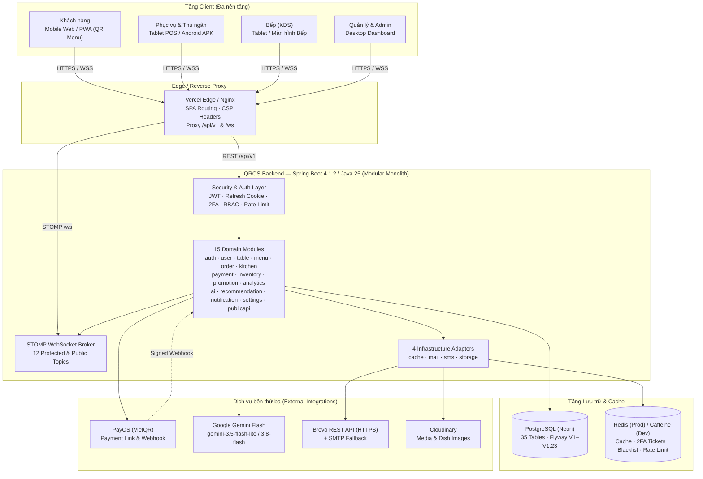
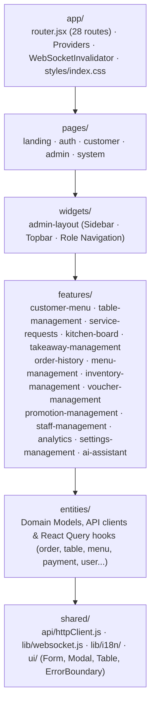
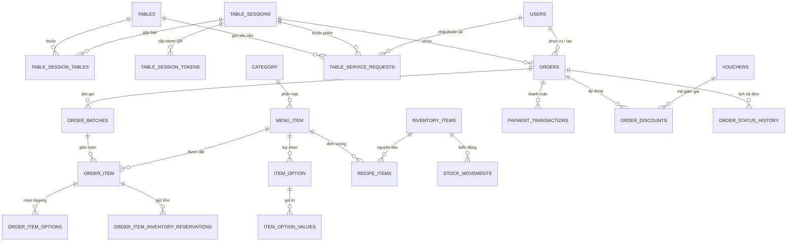
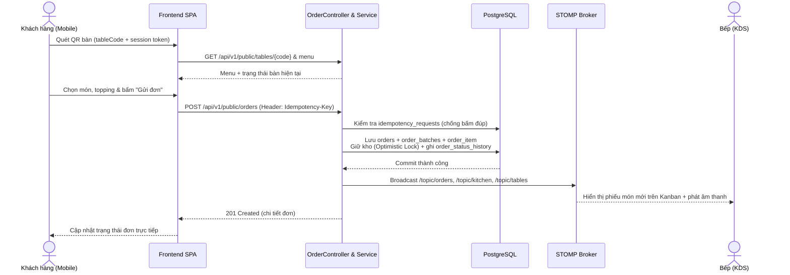
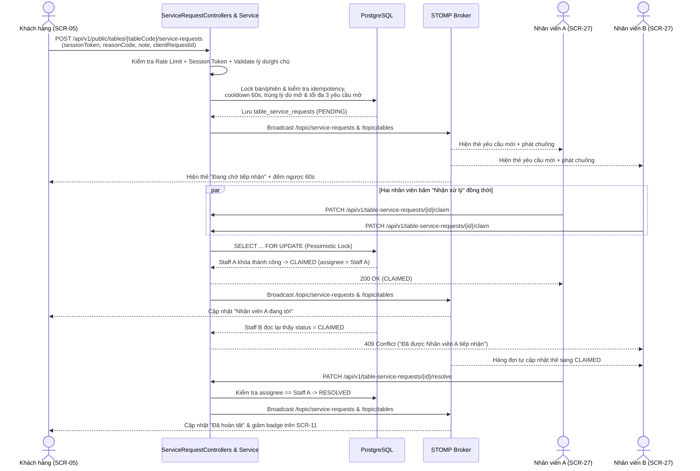
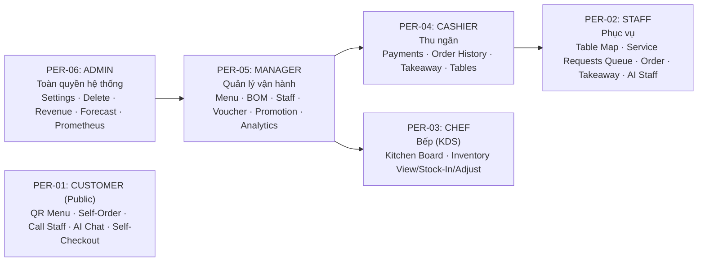
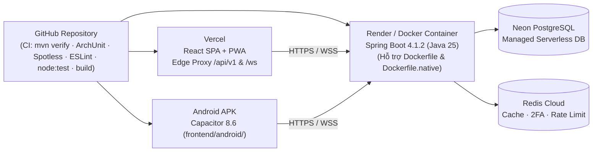

# Tài Liệu Thiết Kế Hệ Thống (System Design Document) — QROS

> **Tầng Knowledge:** `04-tech` (System Design & Technical Architecture · Skill: `.agents/skills/se-system-design`)  
> **Dự án:** QROS — Smart QR Order & Restaurant Operating System  
> **Kế thừa bắt buộc từ:** [KNOWLEDGE_HUB.md](../KNOWLEDGE_HUB.md) · [01-po/blueprint.md](../01-po/blueprint.md) · [02-design/PROTOTYPE_SCREEN_MAP.md](../02-design/PROTOTYPE_SCREEN_MAP.md) · [03-ba/PRD_BY_USER_STAGE.md](../03-ba/PRD_BY_USER_STAGE.md) · [03-ba/USER_STORIES.md](../03-ba/USER_STORIES.md)  
> **Kiến trúc chủ đạo:** Modular Monolith (Spring Boot 4.1.2 / Java 25) + Feature-Sliced Design SPA (React 19.2 / Vite 7 / Tailwind CSS v4) + Android Packaging (Capacitor 8.6)  
> **Cơ sở dữ liệu:** PostgreSQL (35 bảng · 25 Flyway migrations `V1`–`V1.24`) · Cache: Caffeine (Dev) / Redis (Prod)  
> **Bàn giao cho (`05-specs`):** [CONSTITUTION.md](../05-specs/CONSTITUTION.md) · `.agents/skills/sdd-coding-sync`  
> **Phạm vi:** Đặc tả kiến trúc kỹ thuật chuyển tiếp trực tiếp từ Yêu cầu nghiệp vụ (`STG-01` → `STG-06`, `US-001` → `US-034`, `BR-01` → `BR-36`) sang giai đoạn Lập trình (Code).

---

## 1. Tổng quan, Yêu cầu Kiến trúc & Ánh xạ Truy vết từ `01-po` / `02-design` / `03-ba`

### 1.1 Mục tiêu hệ thống
QROS số hóa toàn trình vận hành nhà hàng theo thời gian thực cho **6 nhóm người dùng** theo đúng thứ tự `01-po/personas.md`: `PER-01` (`CUSTOMER`), `PER-02` (`STAFF`), `PER-03` (`CHEF`), `PER-04` (`CASHIER`), `PER-05` (`MANAGER`), `PER-06` (`ADMIN`) trên đa thiết bị (**Mobile Web/PWA**, **Android APK**, **Tablet POS**, **Màn hình Bếp KDS**, **Desktop Admin**).

### 1.2 Yêu cầu phi chức năng (Non-Functional Requirements)

| Nhóm yêu cầu | Mục tiêu thiết kế (từ `01-po` & `03-ba`) | Giải pháp triển khai kỹ thuật trong QROS |
|---|---|---|
| **Realtime & Độ trễ thấp** | Đồng bộ trạng thái bàn, yêu cầu phục vụ, đơn hàng, bếp < 1 giây (`BR-27`) | WebSocket STOMP over SockJS với 12 topic phân quyền |
| **Toàn vẹn dữ liệu & Đồng thời** | Không tạo đơn trùng (`BR-06`), chống spam gọi nhân viên (`BR-26`), chống nhận trùng (`BR-28`), không lệch kho (`BR-11`), không lỗi gộp bàn (`BR-14`) | `idempotency_requests` (Durable Idempotency), Optimistic Locking (`V1.17`), `order_item_inventory_reservations`, Pessimistic Write Lock (`SELECT FOR UPDATE`) + `@Version` cho nhận xử lý yêu cầu bàn, phiên bàn & thanh toán, Partial Unique Index + Rate Limit + Cooldown 60s cho `table_service_requests` (`V1.23`) |
| **Bảo mật đa tầng** | Bảo vệ phiên quản trị (`BR-02`, `BR-03`, `BR-04`), QR bàn (`BR-01`) & thanh toán (`BR-18`, `BR-19`) | JWT + HttpOnly Refresh Cookie (`/api/v1`), Admin 2FA OTP, Account Lockout, Rate Limiting, QR HMAC/Session Token, `RoleHierarchy` |
| **Hiệu năng truy vấn** | Báo cáo doanh thu & thực đơn tải nhanh giờ cao điểm (`BR-23`) | Pre-aggregated Reporting (`daily_*_summary`, `order_reporting_fact`), Caffeine/Redis Cache, FK/Composite Indexes |
| **Đa nền tảng & Khả năng mở rộng** | Dễ mở rộng module, song ngữ `VI/EN` & Light/Dark (`BR-24`) | Backend Modular Monolith kiểm soát bằng ArchUnit; Frontend FSD, Design Tokens 2 tầng, PWA, Capacitor 8.6, i18n |

### 1.3 Ánh xạ Yêu cầu (`03-ba` & `02-design`) → Thành phần Kỹ thuật (`04-tech`)

| User Stage | User Stories & Business Rules (`03-ba`) | Màn hình (`02-design`) | Backend Modules (`com.qros.modules.*`) | Frontend Features (`frontend/src/features/*`) | Bảng SQL & Kênh Realtime cốt lõi |
|---|---|---|---|---|---|
| **`STG-01`** | `US-001`–`US-004` · `BR-01`–`BR-04` | `SCR-01..04`, `SCR-06..09`, `SCR-26` | `auth`, `user`, `table`, `publicapi` | `auth`, `pages/landing`, `pages/system` | `users`, `password_reset_tokens`, `table_session_tokens`, Redis (`qros:2fa:ticket:*`) |
| **`STG-02`** | `US-005`–`US-008`, `US-025`, `US-028` · `BR-05`–`BR-08`, `BR-25`–`BR-26`, `BR-29`–`BR-30` | `SCR-05` | `menu`, `order`, `table`, `ai`, `recommendation`, `publicapi` | `customer-menu`, `ai-assistant` | `category`, `menu_item`, `combos`, `orders`, `order_batches`, `idempotency_requests`, `table_service_requests`, WS `/topic/tables`, `/topic/service-requests` |
| **`STG-03`** | `US-009`–`US-012`, `US-030`, `US-032`–`US-034` · `BR-09`–`BR-12`, `BR-32`, `BR-34`–`BR-36` | `SCR-12`, `SCR-18` | `kitchen`, `inventory`, `ai`, `notification` | `kitchen-board`, `inventory-management` | `order_item`, `order_item_status_history`, `inventory_items` (`unit_cost` `V1.24`), `recipe_items`, `order_item_inventory_reservations`, `stock_movements`, WS `/topic/kitchen`, `/topic/inventory` |
| **`STG-04`** | `US-013`–`US-015`, `US-026`–`US-027`, `US-032` · `BR-13`–`BR-15`, `BR-27`–`BR-28`, `BR-34` | `SCR-11`, `SCR-13`, `SCR-27` | `table`, `order`, `ai`, `notification` | `table-management`, `takeaway-management`, `service-requests` | `tables`, `table_sessions`, `table_session_tables`, `table_service_requests`, `orders`, WS `/topic/tables`, `/topic/orders`, `/topic/service-requests` |
| **`STG-05`** | `US-016`–`US-019` · `BR-16`–`BR-19` | `SCR-05`, `SCR-11`, `SCR-13`, `SCR-14` | `payment`, `promotion`, `table`, `order`, `analytics` | `table-management`, `takeaway-management`, `order-history`, `customer-menu` | `payment_transactions`, `vouchers`, `promotions`, `order_discounts`, `order_status_history`, WS `/topic/tables`, `/topic/orders` |
| **`STG-06`** | `US-020`–`US-024`, `US-029`–`US-031`, `US-033`–`US-034` · `BR-20`–`BR-24`, `BR-31`–`BR-33`, `BR-35`–`BR-36` | `SCR-10`, `SCR-15..26` | `menu`, `inventory`, `promotion`, `user`, `analytics`, `ai`, `settings` | `dashboard-overview`, `menu-management`, `combo-management`, `voucher-management`, `promotion-management`, `inventory-management`, `staff-management`, `analytics`, `settings-management` | `system_settings`, `order_reporting_fact`, `daily_*_summary`, `inventory_items` (`unit_cost`), `recipe_items`, `combos`, `promotions`, WS `/topic/menu`, `/topic/combos`, `/topic/promotions`, `/topic/settings` |

---

## 2. Kiến trúc tổng thể (High-Level Architecture)



---

## 3. Kiến trúc Backend (Modular Monolith)

Backend được tổ chức dạng **Maven single-module** theo kiến trúc **Modular Monolith** tại `backend/src/main/java/com/qros/`, giúp triển khai đơn giản như Monolith nhưng tách biệt ranh giới nghiệp vụ chặt chẽ như Microservices.

### 3.1 Phân rã tầng & Module

| Tầng | Package | Vai trò |
|---|---|---|
| **Core** | `com.qros.core` | Cấu hình hệ thống: `SecurityConfig`, `SecurityRoutes`, `WebSocketConfig`, `CacheConfig`, `TimeZoneConfig`, `DataInitializer`, exception handler toàn cục |
| **Domain Modules (15)** | `com.qros.modules.*` | `ai`, `analytics`, `auth`, `inventory`, `kitchen`, `menu`, `notification`, `order`, `payment`, `promotion`, `publicapi`, `recommendation`, `settings`, `table`, `user` |
| **Infrastructure (4)** | `com.qros.infrastructure.*` | Adapter kết nối ngoài: `cache` (Caffeine/Redis), `mail` (Brevo REST API HTTPS + SMTP fallback), `sms` (OTP template), `storage` (Cloudinary) |
| **Shared** | `com.qros.shared` | Thành phần dùng chung không phụ thuộc nghiệp vụ cụ thể: `constants` (`ApiRoutes`), `idempotency`, `observability`, `validation`, DTO chuẩn phản hồi |

### 3.2 Kiểm soát ranh giới kiến trúc tự động (Architecture Fitness Functions)
- **`BackendDependencyRulesTest` (ArchUnit 1.3.0):** Ép buộc quy tắc phụ thuộc giữa `core`, `modules`, `infrastructure`, `shared` trong mọi lần chạy `mvn verify`, ngăn phụ thuộc vòng hoặc gọi chéo trái phép.
- **`BackendMessageLanguageTest`:** Đảm bảo toàn bộ thông điệp lỗi/phản hồi từ backend tuân thủ quy chuẩn tiếng Anh nhất quán để frontend dịch song ngữ qua i18n.
- **Spotless (`spotless-maven-plugin`):** Tự động kiểm tra định dạng mã nguồn (Palantir Java Format) ở pha `validate`.

---

## 4. Kiến trúc Frontend (Feature-Sliced Design)

Frontend (`frontend/src/`) sử dụng **React 19.2 + Vite 7 + Tailwind CSS v4** theo kiến trúc **Feature-Sliced Design (FSD)**, đóng gói thành **PWA** (`vite-plugin-pwa`) và **Android APK** (`@capacitor/android ^8.6.2`).



### Các quyết định thiết kế Frontend trọng yếu
- **Quản lý State phân tách:**
  - *Server State:* **TanStack React Query** tự động cache, retry và invalidate theo sự kiện WebSocket (`WebSocketInvalidator.jsx`).
  - *Client State:* **Zustand** cho giỏ hàng khách (`src/features/customer-menu/model/cartStore.js`), trạng thái phiên đăng nhập và tùy chọn UI.
- **Dual WebSocket Services:** Tách biệt `publicWsService` (không cần JWT, dùng cho khách hàng tại bàn) và `adminWsService` (đính kèm JWT, dùng cho nhân sự nội bộ).
- **Design System 2 tầng (`Evondev Signature Edition`):** Token tĩnh `@theme` kết hợp biến runtime `:root` / `.dark` trong `index.css`, hỗ trợ `safe-area-inset-*` cho di động và song ngữ `VI`/`EN` qua `useTranslation`.

---

## 5. Thiết kế Cơ sở dữ liệu (Database Design)

Hệ thống sử dụng **PostgreSQL** với **35 bảng** được quản lý nghiêm ngặt qua **25 Flyway migrations** (`V1__Initial.sql` → `V1.24__Inventory_Unit_Cost.sql`, `baseline-on-migrate: false`).

### 5.1 Phân nhóm 35 bảng theo miền nghiệp vụ

| Miền nghiệp vụ | Các bảng chính | Mục đích & cơ chế nổi bật |
|---|---|---|
| **1. Identity & Security** | `users`, `password_reset_tokens`, `system_settings` | 5 vai trò nội bộ, bắt buộc đổi mật khẩu lần đầu (`V1.19`), vô hiệu hóa token cũ (`V1.13`), cấu hình hệ thống & bật/tắt tự thanh toán (`V1.22`) |
| **2. Catalog & Promotion** | `category`, `menu_item`, `item_option`, `item_option_values`, `combos`, `combo_items`, `promotions`, `promotion_days`, `vouchers` | Thực đơn, nhóm tùy chọn/topping, combo, khuyến mãi theo ngày và mã giảm giá |
| **3. Table & Session** | `tables`, `table_sessions`, `table_session_tables`, `table_session_tokens`, `table_service_requests` | Sơ đồ bàn 4 trạng thái (`AVAILABLE`, `OCCUPIED`, `WAITING_FOR_PAYMENT`, `INACTIVE`), phiên phục vụ, **gộp nhiều bàn** (`V1.15`, `V1.16`), token QR theo phiên, **hàng đợi gọi nhân viên** (`V1.23`) với khóa chống trùng lý do đang mở (`uq_tsr_active_table_reason`), idempotency (`uq_tsr_session_client_request`) & `@Version` |
| **4. Order & Kitchen (KDS)** | `orders`, `order_batches`, `order_item`, `order_item_options`, `order_discounts`, `order_status_history`, `order_item_status_history`, `idempotency_requests` | Quản lý đơn hàng nhiều đợt gọi món (`order_batches`), trạng thái bếp (`PENDING → COOKING → FINISHED`), ghi vết lịch sử đầy đủ, chống trùng đơn (`V1.6`) |
| **5. Inventory & Recipe** | `inventory_items` (`unit_cost` `V1.24`), `recipe_items`, `order_item_inventory_reservations`, `stock_movements` | Định lượng nguyên liệu theo món, **giá vốn trên mỗi đơn vị nguyên liệu (`unit_cost` `NUMERIC(15,2)`)** phục vụ Food Cost % & dự toán nhập kho, giữ chỗ tồn kho theo món đang nấu, chống race condition bằng **Optimistic Locking** (`V1.17`), sổ cái xuất/nhập kho |
| **6. Payment & Analytics** | `payment_transactions`, `order_reporting_fact`, `daily_revenue_summary`, `daily_item_sales_summary`, `daily_staff_sales_summary`, `daily_order_activity_summary` | Giao dịch tiền mặt & PayOS VietQR (`V1.14`, `V1.18`, `V1.21`), bảng sự kiện & tổng hợp báo cáo theo ngày tăng tốc thống kê (`V1.4`, `V1.5`, `V1.7`) |

### 5.2 Sơ đồ quan hệ thực thể cốt lõi (Core ERD)



---

## 6. Thiết kế Giao tiếp API, Realtime & Luồng nghiệp vụ chính

### 6.1 Thiết kế REST API (`/api/v1`)
- **Public API (không cần JWT):** `/api/v1/public/orders`, `/api/v1/public/tables/{tableCode}/service-requests` (`GET`, `POST`, `POST /{id}/cancel` — xác thực `sessionToken` + rate limit), `/api/v1/public/settings`, `/api/v1/public/ai/chat` (trả `AiChatResponse(reply, suggestions[])` — `MenuContextProvider` lọc bằng `findAllPublicAvailableItems` + `findAllActiveWithItems`, đối chiếu ID/giá/tùy chọn sống từ DB trước khi trả về), `/api/v1/vouchers/validate`, `/api/v1/recommendations/**`, `/api/v1/webhooks/payos`, `/api/v1/auth/**` (login, refresh, verify/resend 2FA, forgot/reset password).
- **Protected API (JWT + RBAC):** Chia theo tài nguyên chuẩn RESTful (`/tables`, `/table-sessions`, `/table-service-requests` (`GET`, `PATCH /{id}/claim`, `PATCH /{id}/resolve`, `PATCH /{id}/cancel` cho `STAFF`/`CASHIER`/`MANAGER`/`ADMIN`, chặn `CHEF`), `/menu`, `/categories`, `/combos`, `/orders`, `/orders/items`, `/kitchen`, `/payments`, `/inventory/items` (gồm `POST /batch-stock-in` trong `INVENTORY_OPERATION_POST` + `@PreAuthorize("hasAnyRole('MANAGER','CHEF')")` khóa `findAllByIdInForUpdate` theo thứ tự ID tăng dần, chặn `updateUnitCost=true` ở tầng server với `CHEF`), `/promotions`, `/vouchers`, `/users`, `/analytics`, `/settings`, `/ai/staff/query`, `/ai/staff/analyze-notes` (`POST` trong `STAFF_AI_POST` + `@PreAuthorize("hasAnyRole('MANAGER','STAFF','CHEF')")` kèm `NoteSafetyAnalyzer` không hạ cấp `CRITICAL`), `/ai/inventory/restock-suggestions` & `/ai/inventory/recipe-assistant` & `/ai/inventory/invoice-ocr` (`POST`, riêng `invoice-ocr` nhận `multipart/form-data`, kiểm tra chữ ký ảnh bằng `ImageFileValidator`, gọi Gemini Vision `inline_data` ngoài transaction DB và tự quy đổi đơn vị `kg↔g`/`l↔ml`; nằm trong `INVENTORY_AI_POST` + `@PreAuthorize("hasAnyRole('MANAGER','CHEF')")`, quota `operationsUser` `15/1m`, `150/1d`), `/ai/merchandising/combo-suggestions` & `/ai/merchandising/promotion-suggestions` (`POST` trong `MANAGER_POST` + `@PreAuthorize("hasRole('MANAGER')")`, quota `operationsUser`), `/ai/menu-item/description`, `/ai/insights/summary` (`POST` trong `MANAGER_POST` + `@PreAuthorize("hasRole('MANAGER')")` cho `MANAGER`/`ADMIN`; kiểm soát hạn mức `AiQuotaProperties.insightsUser`/`insightsUserDaily`; tổng hợp số liệu từ `ExecutiveInsightsContextProvider` và dự phòng xác định theo quy tắc khi Gemini gián đoạn)).

### 6.2 Thiết kế WebSocket STOMP (`/ws`)

| STOMP Topic | Phạm vi | Quyền Subscribe (đã áp dụng `RoleHierarchy`) | Sự kiện phát tán |
|---|---|---|---|
| `/topic/tables` | Public + Admin | Mọi client (gồm Customer tại bàn) | Thay đổi trạng thái bàn, gộp/hủy gộp bàn, đóng phiên, đồng bộ trạng thái yêu cầu gọi nhân viên an toàn cho màn hình khách (`SCR-05`) |
| `/topic/service-requests` | Protected | `STAFF`, `CASHIER`, `MANAGER`, `ADMIN` *(chặn `CHEF` & `CUSTOMER`)* | Hàng đợi yêu cầu bàn realtime: tạo mới, nhận xử lý (Single-Claim), hoàn tất, hủy & đóng khi kết thúc phiên |
| `/topic/orders` | Protected | `STAFF`, `CASHIER`, `CHEF`, `MANAGER`, `ADMIN` | Tạo đơn mới, cập nhật món, đổi trạng thái đơn |
| `/topic/kitchen` | Protected | `CHEF`, `MANAGER`, `ADMIN` *(chặn `STAFF`/`CASHIER`)* | Đợt gọi món mới đẩy xuống KDS, đổi trạng thái chế biến |
| `/topic/inventory` | Protected | `STAFF`, `CASHIER`, `CHEF`, `MANAGER`, `ADMIN` | Biến động tồn kho, cảnh báo sắp hết nguyên liệu |
| `/topic/promotions` | Protected | `STAFF`, `CASHIER`, `MANAGER`, `ADMIN` | Cập nhật chương trình khuyến mãi |
| `/topic/menu`, `/topic/categories`, `/topic/combos`, `/topic/vouchers`, `/topic/users`, `/topic/settings` | Mixed / Admin | Đồng bộ cache danh mục & cấu hình realtime | Invalidate React Query cache ngay lập tức |

### 6.3 Luồng 1: Khách quét QR → Đặt món Idempotent → KDS Realtime



### 6.4 Luồng 2: Thanh toán VietQR PayOS & Đóng phiên bàn tự động

```mermaid
sequenceDiagram
    actor Actor as Thu ngân / Khách
    participant FE as Frontend POS / Menu
    participant API as PaymentController & PayosService
    participant PayOS as PayOS Gateway
    participant DB as PostgreSQL
    participant WS as STOMP Broker

    Actor->>FE: Chọn thanh toán VietQR (áp dụng voucher nếu có)
    FE->>API: POST /api/v1/payments/payos/create
    API->>DB: Tạo payment_transactions (PENDING) + claim voucher
    API->>PayOS: Tạo link/mã VietQR (gateway_order_code)
    PayOS-->>API: Trả QR code + checkoutUrl
    API-->>FE: Hiển thị mã VietQR
    Actor->>PayOS: Quét QR chuyển khoản ngân hàng
    PayOS->>API: POST /api/v1/webhooks/payos (kèm chữ ký HMAC)
    API->>API: Xác thực chữ ký webhook & chống xử lý lặp
    API->>DB: Cập nhật payment PAID, order COMPLETED,<br/>đóng table_sessions, chuyển bàn về AVAILABLE,<br/>cập nhật daily_*_summary
    API->>WS: Broadcast /topic/tables & /topic/orders
    WS-->>FE: Tự động đóng modal QR & báo thanh toán thành công
```

### 6.5 Luồng 3: Khách gọi nhân viên (Anti-Spam) → Hàng đợi Staff Realtime (Single-Claim Lock)



---

## 7. Kiến trúc Bảo mật & Phân quyền (Security & 6-Role RBAC)

### 7.1 Mô hình phân cấp quyền (`RoleHierarchy`)



### 7.2 Các lớp phòng thủ bảo mật
1. **Xác thực hai token:** Access Token (JWT ngắn hạn gửi qua Header `Authorization: Bearer`) + Refresh Token lưu trong **HttpOnly Cookie** (`Path=/api/v1`, tránh đánh cắp qua XSS). Khi đăng xuất hoặc đổi mật khẩu, token bị thu hồi qua `TokenBlacklistService` (Redis).
2. **Xác thực 2 bước cho Admin (2FA OTP):** Đăng nhập tài khoản `ADMIN` yêu cầu xác minh OTP 6 số lưu trên Redis (`qros:2fa:ticket:*`) với thời hạn ngắn, gửi qua **Brevo REST API** (HTTPS) và chống spam bằng rate limit (`429 Too Many Requests` + cooldown ở UI).
3. **Chống Brute-Force & Account Enumeration:** Kết hợp `AuthRateLimitService` và `AccountLockoutService`; các API quên mật khẩu trả phản hồi trung tính không làm lộ sự tồn tại của email.
4. **Bảo vệ QR tại bàn:** `TableQrSecurityService` xác thực chữ ký/token phiên bàn, ngăn khách ở ngoài quán giả mạo URL để gửi đơn rác.
5. **Bảo vệ gọi nhân viên & hàng đợi yêu cầu bàn:** Mọi yêu cầu `POST /api/v1/public/tables/{tableCode}/service-requests` phải xác thực `sessionToken` hợp lệ của phiên đang mở kết hợp `RateLimitingFilter` (`public:service-requests`) và cooldown DB; các endpoint `/api/v1/table-service-requests/**` và STOMP `/topic/service-requests` chỉ cấp cho `STAFF`/`CASHIER`/`MANAGER`/`ADMIN` (chặn `CHEF` và `CUSTOMER`).
6. **Bảo mật tầng HTTP Edge:** `vercel.json` & `SecurityConfig` thiết lập `Content-Security-Policy` (CSP), `Permissions-Policy: unload=(self)`, CORS giới hạn theo origin hợp lệ và vô hiệu hóa CSRF cho API stateless.

---

## 8. Hiệu năng, Độ tin cậy & Khả năng quan sát

- **Chiến lược Caching 2 môi trường:** Mặc định dùng **Caffeine** in-memory ở môi trường Dev để khởi động nhanh không cần dịch vụ phụ, tự động chuyển sang **Redis** (`SPRING_CACHE_TYPE=redis`) ở Production để chia sẻ cache, blacklist JWT, 2FA ticket và rate-limit counter giữa các instance.
- **Tối ưu báo cáo (CQRS-lite / Pre-aggregation):** Thay vì quét toàn bộ bảng `orders` và `order_item` cho biểu đồ doanh thu, `DailySummaryRefreshService` cập nhật tăng dần vào `order_reporting_fact` và 4 bảng `daily_*_summary`.
- **Cô lập lỗi dịch vụ ngoài (Graceful Degradation):**
  - *Gemini AI:* Có `AiQuotaService` giới hạn lượt gọi theo vai trò và fallback an toàn khi vượt hạn mức hoặc timeout.
  - *Email:* Ưu tiên **Brevo REST API qua HTTPS** (tránh bị cloud provider như Render chặn cổng SMTP 25/465/587), tự động dự phòng SMTP khi chạy local không cấu hình API key.
- **Observability:** Spring Boot Actuator expose `/actuator/health` (public cho healthcheck) và `/actuator/prometheus` (giới hạn quyền `ADMIN`) để giám sát JVM, HikariCP pool và độ trễ API.

---

## 9. Kiến trúc Triển khai & Quy trình CI/CD

### 9.1 Hạ tầng triển khai Production



### 9.2 Cổng kiểm soát chất lượng (Quality Gates — khớp CI & `05-specs/CONSTITUTION.md`)
- **Backend *(Java 25)*:** `mvn -f backend/pom.xml --batch-mode verify` chạy **56 bộ test** (Unit, Integration, `CoreApiSecurityIntegrationTest`, `BackendDependencyRulesTest`, `BackendMessageLanguageTest`) kèm `spotless:check`.
- **Frontend *(Node 22)*:** `npm --prefix frontend test` (**15** unit test suites với `node:test`) + `npm --prefix frontend run lint` (ESLint) + `npm --prefix frontend run build`.
- **E2E & Visual QA:** Bộ kịch bản Playwright (`scripts/phase4_full_ui_audit.js`, `scripts/android_audit.js`) kiểm thử toàn bộ 6 vai trò trên 3 kích thước màn hình (144 ảnh chụp kiểm chứng tại `screenshots/`).
- **Chuyển giao sang Pha Code (`05-specs/`):** Mọi tính năng mới triển khai theo quy trình SDD tại [CONSTITUTION.md](../05-specs/CONSTITUTION.md) và `.agents/skills/sdd-coding-sync`.
