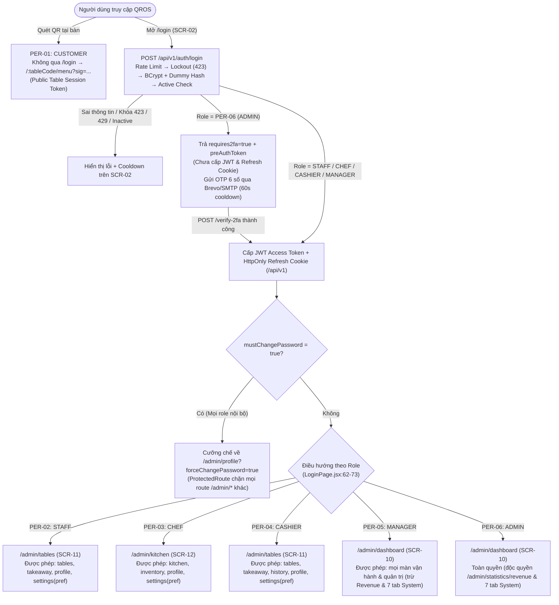

# Spec `003`: Role-Based Authentication & Login Flow (Đăng nhập & Điều hướng theo 6 Vai trò)

- **Type:** `Baseline Spec (dựng ngược từ code có sẵn — Mẫu demo luồng Đăng nhập & Phân quyền theo từng Role)`
- **Branch / Track:** `Nhánh C (Brownfield Baseline / Sync-Back — Vùng nhạy cảm Auth/RBAC, không đi Fast Track)`
- **Status:** `Implemented (Pending Sync-Back Review)` *(Giữ nguyên trạng thái chờ duyệt để demo quy trình Sync-Back trước thầy; chưa chuyển `Archived`)*
- **Source of Truth:**
  - PO: [personas.md](../../01-po/personas.md) (`PER-01` → `PER-06`) · [journey-features.md](../../01-po/journey-features.md) (`STG-01`, `F1.1`, `F6.4`)
  - Design: [PROTOTYPE_SCREEN_MAP.md](../../02-design/PROTOTYPE_SCREEN_MAP.md) (`SCR-02`, `SCR-03`, `SCR-04`, `SCR-06`, `SCR-10`, `SCR-11`, `SCR-12`, `SCR-26`)
  - BA PRD: [PRD_BY_USER_STAGE.md](../../03-ba/PRD_BY_USER_STAGE.md) (`BR-02`, `BR-03`, `BR-04`)
  - BA User Stories: [USER_STORIES.md](../../03-ba/USER_STORIES.md) (`US-002`, `US-003`, `US-004`)
  - Tech: [SYSTEM_DESIGN.md](../../04-tech/SYSTEM_DESIGN.md) (§7 Security & 6-Role RBAC)

> **Lưu ý minh bạch khi demo:** Quy luật chuẩn cho tính năng mới là **chiều thuận** (`01-po → 02-design → 03-ba → 04-tech → 05-specs → Sinh Code`). Tài liệu này là **Baseline Spec dựng ngược từ mã nguồn xác thực thực tế** để demo trọn vẹn luồng đăng nhập, xác thực 2FA, cưỡng chế đổi mật khẩu và phân quyền điều hướng theo từng vai trò trong 6 vai trò của QROS.

---

## 1. Luồng Đăng nhập & Điều hướng Phân nhánh theo 6 Vai trò (`PER-01` → `PER-06`)

---

## 2. Ma trận Chi tiết Đăng nhập & Kiểm soát Truy cập theo từng Vai trò (Xác minh từ `router.jsx` & `LoginPage.jsx`)

| Persona / Role | Kênh vào & Số bước xác thực | Trang đích mặc định sau đăng nhập | Routes `/admin/*` được phép (`ProtectedRoute`) | Hành vi khi cố mở route trái quyền |
|---|---|---|---|---|
| **`PER-01` (`CUSTOMER`)** | Quét QR bàn (`/:tableCode/menu?sig=...`), **0 bước login** | `/:tableCode/menu` (`SCR-05`) | Không có *(mọi `/admin/*` bị đẩy về `/login`)* | Chuyển hướng `/login` |
| **`PER-02` (`STAFF`)** | `/login` (**1 bước:** Email + Password) | `/admin/tables` (`SCR-11`) | `/admin/tables`, `/admin/takeaway`, `/admin/profile`, `/admin/settings` *(Preferences)* | Chuyển hướng `/unauthorized` (`SCR-06`) |
| **`PER-03` (`CHEF`)** | `/login` (**1 bước:** Email + Password) | `/admin/kitchen` (`SCR-12`) | `/admin/kitchen`, `/admin/inventory`, `/admin/profile`, `/admin/settings` *(Preferences)* | Chuyển hướng `/unauthorized` (`SCR-06`) |
| **`PER-04` (`CASHIER`)** | `/login` (**1 bước:** Email + Password) | `/admin/tables` (`SCR-11`) | `/admin/tables`, `/admin/takeaway`, **`/admin/history`**, `/admin/profile`, `/admin/settings` *(Preferences)* | Chuyển hướng `/unauthorized` (`SCR-06`) |
| **`PER-05` (`MANAGER`)** | `/login` (**1 bước:** Email + Password) | `/admin/dashboard` (`SCR-10`) | Toàn bộ nhóm vận hành & quản trị (`/dashboard`, `/categories`, `/menu`, `/combo`, `/voucher`, `/promotions`, `/staffs`, `/statistics/top-dishes`, `/statistics/staff`, `/history`, `/tables`, `/takeaway`, `/kitchen`, `/inventory`, `/profile`, `/settings` Preferences) | Chặn `/admin/statistics/revenue` → `/unauthorized`; Backend trả `403` cho API `ADMIN`-only |
| **`PER-06` (`ADMIN`)** | `/login` (**2 bước bắt buộc:** Password → OTP 6 số Email) | `/admin/dashboard` (`SCR-10`) | **Toàn bộ** `/admin/*`, độc quyền `/admin/statistics/revenue` (`SCR-22`) và 7 tab cấu hình hệ thống (`SCR-26`) | Toàn quyền |

---

## 3. Các cơ chế Bảo mật Xác minh thực tế từ Mã nguồn
1. **Phòng thủ Timing-Attack User Enumeration (`AuthService.java:90-96`):** Luôn chạy BCrypt `matches` với `dummyPasswordHash` ngay cả khi email không tồn tại để thời gian phản hồi đồng nhất.
2. **Account Lockout (HTTP 423) & Rate Limit (HTTP 429) (`AuthController.java:98`, `LoginPage.jsx:103-107`):** Khóa tạm sau 5 lần sai mật khẩu liên tiếp (mặc định 15 phút), hiển thị chính xác thời gian chờ `retryAfterSeconds`.
3. **Kiểm tra trạng thái hoạt động (`UserStatus.ACTIVE`):** Tài khoản ngưng hoạt động bị từ chối (`ACCOUNT_INACTIVE`) ở cả `login()` lẫn `complete2faLogin()`.
4. **Admin 2FA OTP an toàn (`AuthController.java:101-142`, `Admin2faService`):** Bước 1 không cấp token/cookie mà chỉ cấp `preAuthToken` + email đã che; bước 2 giới hạn tần suất `verify-2fa` và `resend-2fa` (cooldown 60s trên UI).
5. **Cưỡng chế đổi mật khẩu lần đầu (`ProtectedRoute.jsx:12-14`):** Nếu `user.mustChangePassword = true`, mọi điều hướng tới route khác `/admin/profile` đều bị chặn và ép quay về `/admin/profile?forceChangePassword=true`.
6. **Chống CSRF cho Refresh/Logout Cookie (`AuthController.java:146,160`):** `CookieRequestOriginValidator.requireAllowedOrigin(request)` kiểm tra Origin hợp lệ trước khi cấp lại token hoặc thu hồi phiên trên Redis (`TokenBlacklistService`).

---

## 4. Sync-Back Proposal (Chờ người dùng duyệt — CHƯA ghi vào nguồn chân lý)

| # | ID / Phạm vi ảnh hưởng | File nguồn chân lý | Điểm lệch phát hiện khi đối chiếu code thật | Diff đề xuất |
|---|---|---|---|---|
| **SB-08** | `SCR-17`, `SCR-19`, `SCR-21`, `SCR-25` | [PROTOTYPE_SCREEN_MAP.md](../../02-design/PROTOTYPE_SCREEN_MAP.md#L56-L65) | 3 đường dẫn đề xuất đang ghi số nhiều/ít lệch nhẹ so với `router.jsx` (`/admin/combos` vs `/admin/combo`, `/admin/vouchers` vs `/admin/voucher`, `/admin/staff` vs `/admin/staffs`), và `SCR-25` (`/admin/analytics/forecast`) chưa tách thành route độc lập trong `router.jsx`. | Cập nhật cột đường dẫn trong `PROTOTYPE_SCREEN_MAP.md` khớp chính xác `router.jsx` (hoặc ghi chú `SCR-25` tích hợp trong Dashboard/Analytics). |
| **SB-09** | `BR-03`, `US-002`, `US-004` | [PRD_BY_USER_STAGE.md](../../03-ba/PRD_BY_USER_STAGE.md#L52) · [USER_STORIES.md](../../03-ba/USER_STORIES.md#L27-L61) | Chưa nêu rõ 2 ràng buộc đang chạy thật: *(1)* tài khoản trạng thái *Ngưng hoạt động* bị từ chối đăng nhập ở cả bước mật khẩu lẫn bước hoàn tất 2FA; *(2)* khi `mustChangePassword = true`, hệ thống **cưỡng chế khóa mọi màn hình quản trị khác** cho tới khi đổi mật khẩu xong. | Bổ sung 2 ràng buộc trên vào `BR-03` và AC của `US-002` / `US-004`. |
| **SB-10** | Security Layers (§7.2) | [SYSTEM_DESIGN.md](../../04-tech/SYSTEM_DESIGN.md#L270-L276) | §7.2 chưa ghi rõ 3 cơ chế đã cài đặt trong `modules/auth`: *(1)* chống timing-attack bằng `dummyPasswordHash`, *(2)* `CookieRequestOriginValidator` kiểm tra Origin cho `/refresh` & `/logout`, và *(3)* kênh khôi phục mật khẩu hỗ trợ thêm qua **Phone/SMS** (`PhonePasswordResetRequest`). | Bổ sung 3 chi tiết bảo mật trên vào §7.2 của `SYSTEM_DESIGN.md`. |

> **Hành động tiếp theo:** Người dùng duyệt từng dòng `SB-08` → `SB-10`. Chỉ sau khi duyệt, agent mới ghi diff vào các file nguồn chân lý, thêm 1 dòng vào `Sync Changelog` tại `KNOWLEDGE_HUB.md` và đổi `Status` sang `Archived`.
