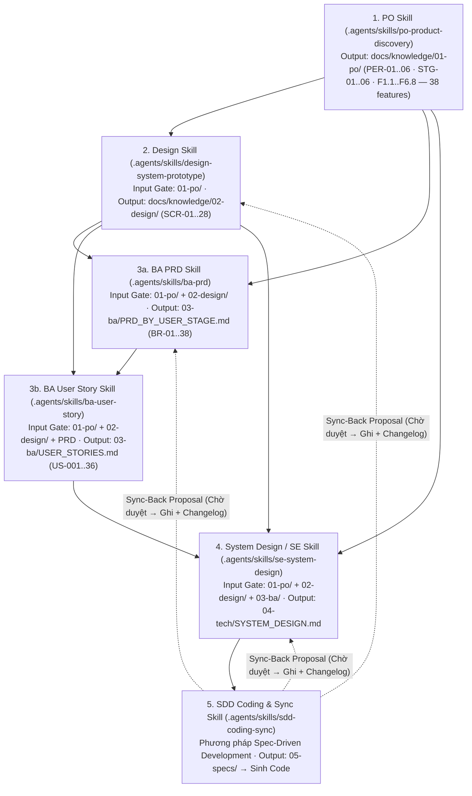

# QROS Knowledge Hub — Single Source of Truth

> **Mục đích:** Điểm tập trung duy nhất toàn bộ tri thức sản phẩm và kỹ thuật của dự án **QROS (Smart QR Order & Restaurant Operating System)**, đảm bảo mọi vai trò (**PO → Design → BA → Tech/SE → SDD Coding**) luôn làm việc trên cùng một nguồn dữ liệu thống nhất và đi theo **quy luật chiều thuận để sinh ra code**.

---

## 1. Kiến trúc Chuỗi liên kết Knowledge (Forward Pipeline → Sinh Code)

> **Nguyên tắc vàng:**
> 1. **Chiều thuận là quy luật chuẩn:** Mọi tính năng mới đi từ **PO (`01-po`) → Design (`02-design`) → BA (`03-ba`) → System Design (`04-tech`) → Spec/Plan/Tasks (`05-specs`) → Sinh Code**.
> 2. **Phân tách sạch ngôn ngữ từng vai trò:** `01-po/` nói ngôn ngữ sản phẩm & kinh doanh; `02-design/` nói ngôn ngữ UI/UX & Design Tokens; `03-ba/` nói ngôn ngữ nghiệp vụ, quy tắc & kiểm thử (`Given/When/Then`); từ `04-tech/` trở đi mới đi sâu vào công nghệ, API, DB và Code.
> 3. **Không tự ghi đè nguồn chân lý:** Mọi đề xuất đồng bộ ngược từ code phải qua bước **Sync-Back Proposal** do người duyệt rồi mới ghi kèm 1 dòng `Sync Changelog`.

---

## 2. Chỉ mục Kho Knowledge Tập trung (`docs/knowledge/`)

### Tầng 1 — Product Owner (`01-po/`) · Skill: `po-product-discovery`
*Thuần ngôn ngữ sản phẩm, thị trường & trải nghiệm (0 thuật ngữ code/SQL/API).*

| Tài liệu | Nội dung cốt lõi | Trạng thái |
|---|---|---|
| [project-intake.md](./01-po/project-intake.md) | Tiếp nhận ý tưởng dự án, In-Scope / Out-of-Scope, Stakeholder Matrix (`PER-01` → `PER-06`), ràng buộc sản phẩm | ✅ Sẵn sàng |
| [source-preparation.md](./01-po/source-preparation.md) | Khảo sát thực địa, mô hình khái niệm nghiệp vụ 8 nhóm thực thể & bằng chứng số liệu 30 ngày | ✅ Sẵn sàng |
| [problem.md](./01-po/problem.md) | Phân tích nỗi đau As-Is của 6 vai trò, 5 Whys & định lượng tổn thất vận hành | ✅ Sẵn sàng |
| [personas.md](./01-po/personas.md) | Chân dung 6 nhóm người dùng: `PER-01` Customer, `PER-02` Staff, `PER-03` Chef, `PER-04` Cashier, `PER-05` Manager, `PER-06` Admin | ✅ Sẵn sàng |
| [vision.md](./01-po/vision.md) | Tuyên ngôn tầm nhìn, North Star Metric (`PTJR`), 3 trụ cột giá trị, Value Proposition & OKRs | ✅ Sẵn sàng |
| [market.md](./01-po/market.md) | Phân tích 4 nhóm đối thủ thay thế & 5 lợi thế khác biệt của QROS | ✅ Sẵn sàng |
| [blueprint.md](./01-po/blueprint.md) | Business Model Canvas, Service Blueprint *(Frontstage / Backstage / Support)* & quản trị rủi ro kinh doanh | ✅ Sẵn sàng |
| [roadmap.md](./01-po/roadmap.md) | Lộ trình sản phẩm 4 giai đoạn (MVP → Enterprise), Product Release Gates & quản trị rủi ro | ✅ Sẵn sàng |
| [journey-features.md](./01-po/journey-features.md) | Hành trình 6 User Stages (`STG-01` → `STG-06`), 6 Epics (`F1.1` → `F6.7` — 37 features, gồm `F2.6`, `F5.6`–`F5.8`, `F6.6`–`F6.7`) & ma trận phụ thuộc nghiệp vụ | ✅ Sẵn sàng |

### Tầng 2 — Product Design (`02-design/`) · Skill: `design-system-prototype`
*Input bắt buộc: `01-po/` · Thuần ngôn ngữ UI/UX & Design Tokens.*

| Tài liệu | Nội dung cốt lõi | Trạng thái |
|---|---|---|
| [DESIGN_SYSTEM.md](./02-design/DESIGN_SYSTEM.md) | QROS Master Design System v3.0 (*Evondev Signature*), Token 2 tầng, Light/Dark WCAG 2.1 AA, Typography & Patterns | ✅ Sẵn sàng |
| [figma-tokens.json](./02-design/figma-tokens.json) | Bộ Design Tokens chuẩn JSON đồng bộ Figma ↔ Dev | ✅ Sẵn sàng |
| [PROTOTYPE_SCREEN_MAP.md](./02-design/PROTOTYPE_SCREEN_MAP.md) | Bản đồ 27 màn hình (`SCR-01` → `SCR-27`, gồm cập nhật `SCR-05`, `SCR-10`–`SCR-12`, `SCR-17`–`SCR-18`, `SCR-20`, `SCR-27`) gắn 1-1 với `PER-01..06`, `F1.1..F6.7` & 5 trạng thái UI chuẩn | ✅ Sẵn sàng |
| [figma/](./02-design/figma/) | Figma plugins & scripts sinh canvas/hifi auth | ✅ Sẵn sàng |

### Tầng 3 — Business Analysis (`03-ba/`) · Skills: `ba-prd` & `ba-user-story`
*Input bắt buộc: `01-po/` + `02-design/` · Thuần ngôn ngữ nghiệp vụ & Acceptance Criteria.*

| Tài liệu | Nội dung cốt lõi | Trạng thái |
|---|---|---|
| [PRD_BY_USER_STAGE.md](./03-ba/PRD_BY_USER_STAGE.md) | Phân tích chi tiết **6 User Stages** (`STG-01` → `STG-06`), Ma trận phân quyền, **36 Business Rules** (`BR-01` → `BR-36`), State Machines & Edge Cases | ✅ Sẵn sàng |
| [USER_STORIES.md](./03-ba/USER_STORIES.md) | Backlog **34 User Stories** (`US-001` → `US-034`) chuẩn `Given/When/Then`, phủ 100% `F1.1..F6.7` & `SCR-01..27` | ✅ Sẵn sàng |

### Tầng 4 — System Design & Engineering (`04-tech/`) · Skill: `se-system-design`
*Input bắt buộc: `01-po/` + `02-design/` + `03-ba/`*

| Tài liệu | Nội dung cốt lõi | Trạng thái |
|---|---|---|
| [SYSTEM_DESIGN.md](./04-tech/SYSTEM_DESIGN.md) | Ánh xạ `US/BR/SCR` → Kiến trúc Modular Monolith (Spring Boot 4.1.2 / Java 25) + FSD (React 19.2 / Capacitor 8.6), 35 bảng DB (`V1`–`V1.26`), 12 STOMP topics, 6-Role RBAC & CI Quality Gates | ✅ Sẵn sàng |

### Tầng 5 — Spec-Driven Execution & Sync (`05-specs/`) · Skill: `sdd-coding-sync`
*Áp dụng phương pháp Spec-Driven Development (lấy cảm hứng từ GitHub Spec Kit). Luồng chuẩn là **chiều thuận sinh ra code** (`Nhánh A`). Thư mục này chỉ là **lịch sử thực thi** (`Draft → In Progress → Implemented → Archived`), không phải bản sao thứ hai của `03-ba/` hay `04-tech/`. Riêng `001-`..`003-` là **Baseline Spec dựng ngược từ code có sẵn** để minh họa quy trình duyệt Sync-Back.*

| Tài liệu | Loại & Nội dung cốt lõi | Trạng thái |
|---|---|---|
| [CONSTITUTION.md](./05-specs/CONSTITUTION.md) | Chỉ mục 10 luật bất biến (trỏ link nguồn gốc, gắn nhãn Auto/Manual) & DoD khớp 100% CI | ✅ Sẵn sàng |
| [001-customer-self-checkout/](./05-specs/001-customer-self-checkout/spec.md) | **Baseline Spec** *(ví dụ dựng ngược từ code `V1.22`)* — kèm Sync-Back Proposal (`SB-01` → `SB-04`) | ⏳ `Pending Sync-Back Review` |
| [002-customer-table-order/](./05-specs/002-customer-table-order/spec.md) | **Baseline Spec** *(mẫu demo luồng cốt lõi Khách đặt món tại bàn)* — kèm Sync-Back Proposal (`SB-05` → `SB-07`) | ⏳ `Pending Sync-Back Review` |
| [003-role-based-auth-login/](./05-specs/003-role-based-auth-login/spec.md) | **Baseline Spec** *(mẫu demo luồng Đăng nhập, 2FA & Điều hướng theo 6 Role)* — kèm Sync-Back Proposal (`SB-08` → `SB-10`) | ⏳ `Pending Sync-Back Review` |
| [004-table-service-requests/](./05-specs/004-table-service-requests/spec.md) | **New Feature (`Nhánh A`)** — Gọi nhân viên tại bàn (`F1.6`, `BR-25..26`, `US-025`) & Hàng đợi yêu cầu bàn realtime (`F4.5`, `SCR-27`, `BR-27..28`, `US-026..027`, `V1.23`) | ✅ `Archived` |
| [005-ai-ordering-and-executive-insights/](./05-specs/005-ai-ordering-and-executive-insights/spec.md) | **New Feature (`Nhánh A`)** — AI Đặt món trực tiếp từ Chat (`F1.5`, `SCR-05`, `BR-29..30`, `US-028`) & AI Tóm tắt điều hành Dashboard (`F6.6`, `SCR-10`, `BR-31`, `US-029`) | ✅ `Archived` |
| [006-ai-operations-suite/](./05-specs/006-ai-operations-suite/spec.md) | **New Feature (`Nhánh A`)** — AI Nhập kho BOM+Dự báo (`F5.6`), AI Đề xuất Combo & Khung giờ KM (`F6.7`), AI Dị ứng & Ghi chú (`F2.6`), AI BOM & Giá vốn (`F5.7`, `V1.24`) | ✅ `Archived` |
| [007-ai-invoice-stock-in/](./05-specs/007-ai-invoice-stock-in/spec.md) | **New Feature (`Nhánh A`)** — Nhập kho từ ảnh hóa đơn bằng Gemini Vision (`F5.8`, `SCR-18`, `BR-36`, `US-034`) | ✅ `Archived` |
| [008-pro-subscription-paywall/](./05-specs/008-pro-subscription-paywall/spec.md) | **New Feature (`Nhánh A`)** — Hệ thống Nâng cấp Gói Pro & Paywall Free/Pro + PayOS VietQR (`F6.8`, `SCR-28`, `BR-37..38`, `US-035..036`, `V1.27`) | ✅ `Implemented (Pending Sync-Back Review)` |

---

## 3. Ma trận Truy vết End-to-End (100% đồng bộ 5 Tầng)

| User Stage | Mô tả giai đoạn | Personas (`01-po`) | PO Features (`01-po`) | Design Screens (`02-design`) | Business Rules (`03-ba`) | User Stories (`03-ba`) | Tech Modules (`04-tech`) |
|---|---|---|---|---|---|---|---|
| **`STG-01`** | Khám phá, Quét QR, Xác thực & 2FA | `PER-01..06` | `F1.1`, `F6.4`, `F6.5` | `SCR-01..04`, `SCR-06..09`, `SCR-26` | `BR-01` → `BR-04` | `US-001` → `US-004` | `auth`, `user`, `table`, `publicapi` |
| **`STG-02`** | Duyệt thực đơn, AI gợi ý, Đặt món & Gọi hỗ trợ | `PER-01` | `F1.2`–`F1.6` | `SCR-05` | `BR-05` → `BR-08`, `BR-25` → `BR-26`, `BR-29` → `BR-30` | `US-005` → `US-008`, `US-025`, `US-028` | `menu`, `order`, `table`, `ai`, `recommendation`, `publicapi` |
| **`STG-03`** | Tiếp nhận Bếp (KDS) & Giữ/Trừ kho | `PER-03`, `PER-05` | `F2.1`–`F2.6`, `F5.1`–`F5.8` | `SCR-12`, `SCR-18` | `BR-09` → `BR-12`, `BR-32`, `BR-34` → `BR-36` | `US-009` → `US-012`, `US-030`, `US-032` → `US-034` | `kitchen`, `inventory`, `ai`, `notification` |
| **`STG-04`** | Phục vụ tại bàn, Hàng đợi yêu cầu, Gộp bàn & Mang về | `PER-02`, `PER-04`, `PER-05`, `PER-06` | `F4.1`–`F4.5`, `F2.6` | `SCR-11`, `SCR-13`, `SCR-27` | `BR-13` → `BR-15`, `BR-27` → `BR-28`, `BR-34` | `US-013` → `US-015`, `US-026` → `US-027`, `US-032` | `table`, `order`, `ai`, `notification` |
| **`STG-05`** | Thanh toán Tiền mặt / VietQR & Đóng bàn | `PER-01`, `PER-04`, `PER-05` | `F3.1`–`F3.5`, `F6.5` | `SCR-05`, `SCR-11`, `SCR-13`, `SCR-14` | `BR-16` → `BR-19` | `US-016` → `US-019` | `payment`, `promotion`, `table`, `order`, `analytics` |
| **`STG-06`** | Quản trị Thực đơn, Kho, Nhân sự, Thống kê & AI | `PER-05`, `PER-06` | `F5.1`–`F5.8`, `F6.1`–`F6.8` | `SCR-10`, `SCR-15..26`, `SCR-28` | `BR-20` → `BR-24`, `BR-31`–`BR-33`, `BR-35`–`BR-38` | `US-020` → `US-024`, `US-029`–`US-031`, `US-033`–`US-036` | `menu`, `inventory`, `promotion`, `user`, `analytics`, `ai`, `settings`, `subscription` |

---

## 4. Cổng kiểm soát bàn giao (Handoff Readiness Checklist)
- [x] **Gate 1 (`01-po` → `02-design`):** 9 tài liệu thuần tư duy PO (`PER-01..06`, `STG-01..06`, `F1.1..F6.7` — 37 features), 0 thuật ngữ code.
- [x] **Gate 2 (`01-po` + `02-design` → `03-ba`):** Đủ Design System (`DESIGN_SYSTEM.md`, `figma-tokens.json`) và 27 màn hình Prototype (`SCR-01..27`) thuần UI/UX.
- [x] **Gate 3 (`03-ba` → `04-tech`):** Đủ PRD theo 6 User Stages (`BR-01..36`) và 34 User Stories (`US-001..34`) phủ 100% mã từ PO & Design, thuần nghiệp vụ.
- [x] **Gate 4 (`04-tech` → `05-specs` / Sinh Code):** Đủ `SYSTEM_DESIGN.md` ánh xạ 1-1 `STG/US/BR/SCR` xuống kiến trúc thực tế (Spring Boot 4.1.2 / Java 25, React 19.2, 35 bảng `V1`–`V1.26`, 12 STOMP topics) và `CONSTITUTION.md` (DoD khớp CI).
- [x] **Gate 5 (`05-specs` → Đã duyệt Sync-Back & Lưu trữ):**
  - **Baseline Sync-Back Demo (giữ nguyên phục vụ trình bày):** `001-customer-self-checkout` (`SB-01` → `SB-04`), `002-customer-table-order` (`SB-05` → `SB-07`), `003-role-based-auth-login` (`SB-08` → `SB-10`) giữ trạng thái `Pending Sync-Back Review`.
  - **Tính năng mới đã triển khai (`Nhánh A`):** `004-table-service-requests`, `005-ai-ordering-and-executive-insights`, `006-ai-operations-suite`, `007-ai-invoice-stock-in` đã hoàn tất mã nguồn, kiểm thử, đồng bộ ngược và đóng trạng thái lưu trữ (`Archived`).

---

## 5. Sync Changelog (Lịch sử Đồng bộ Ngược có kiểm duyệt)

| Ngày | Spec ID | Các ID / Tài liệu cập nhật | Trạng thái & Người duyệt |
|---|---|---|---|
| `2026-11-22` | `001-customer-self-checkout` *(Baseline demo)* | Đề xuất `SB-01` → `SB-04` (`BR-19`, `US-018`, `SCR-05`, `SYSTEM_DESIGN.md §6.1`) | ⏳ Chờ duyệt *(giữ demo trình bày)* |
| `2026-11-22` | `002-customer-table-order` *(Baseline demo)* | Đề xuất `SB-05` → `SB-07` (`BR-05`, `BR-06`, `US-007`, `SYSTEM_DESIGN.md §6.1, §6.3`) | ⏳ Chờ duyệt *(giữ demo trình bày)* |
| `2026-11-22` | `003-role-based-auth-login` *(Baseline demo)* | Đề xuất `SB-08` → `SB-10` (`SCR-17/19/21/25`, `BR-03`, `US-002/004`, `SYSTEM_DESIGN.md §7.2`) | ⏳ Chờ duyệt *(giữ demo trình bày)* |
| `2026-11-23` | `004`–`007` *(Feature sync status)* | Đồng bộ trạng thái `004` (`Implemented`) & danh mục `004`–`007` trong `KNOWLEDGE_HUB.md` | ✅ Đã đóng `Archived` *(2026-11-26)* |
| `2026-11-23` | `Architecture & Doc Alignment` | Đồng bộ `PROTOTYPE_SCREEN_MAP.md` (`SCR-05/17/19/21/25/26`), `USER_STORIES.md` (`SCR-07/09`), `SYSTEM_DESIGN.md`, `CONSTITUTION.md`, `.agents/`, `CLAUDE.md` & READMEs sau refactor Modular Monolith (0 cycle, 0 cross-repo) + FSD strict ESLint | ✅ Đã duyệt bởi User *(2026-11-23)* |
| `2026-11-26` | `Audit Hardening (Waves 1–3 · 42 Issues)` | Đồng bộ `SB-11` → `SB-18` (`PROTOTYPE_SCREEN_MAP.md` [`SCR-05/11/13/14/22/25/26`], `PRD_BY_USER_STAGE.md` [`BR-02..05`, `BR-10..11`, `BR-13..14`, `BR-16..19`, `BR-21..22`], `USER_STORIES.md` [`US-002..004`, `US-014`, `US-016..018`, `US-023`], `SYSTEM_DESIGN.md` [`V1.25`, RBAC, locking, PayOS, tax/service charge, infra & CI 347+153 tests]) | ✅ Đã duyệt bởi User *(2026-11-26)* |
| `2026-11-26` | `Wave 2 Pre-Release Hardening (34 Issues · W2-1..W2-7)` | Đồng bộ `SB-19` → `SB-24` (`PROTOTYPE_SCREEN_MAP.md` [`SCR-05/11/12/14/15/17/26`], `PRD_BY_USER_STAGE.md` [`BR-02..03`, `BR-05`, `BR-07`, `BR-10..11`, `BR-14`, `BR-16..18`, `BR-27`, `BR-36`], `USER_STORIES.md` [`US-002/005/007/009/016/017/020/034`], `SYSTEM_DESIGN.md` [`V1.26`, multi-device sessions, operating hours, Happy-Hour snapshot, G1GC/Virtual Threads, PWA/Capacitor, Testcontainers PG16+Redis7 364+160 tests]) | ✅ Đã duyệt bởi User *(2026-11-26)* |
| `2026-11-26` | `004`–`007` *(Gate 5 Closure)* | Đóng trạng thái `Archived` cho `004-table-service-requests`, `005-ai-ordering-and-executive-insights`, `006-ai-operations-suite`, `007-ai-invoice-stock-in` (`spec.md` + `tasks.md`) và hoàn tất **Gate 5** trong `KNOWLEDGE_HUB.md` *(giữ nguyên `001`–`003` làm Baseline Demo)* | ✅ Đã duyệt bởi User *(2026-11-26)* |
